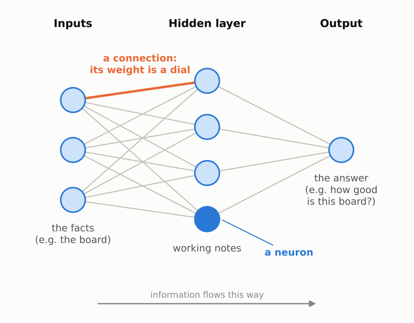
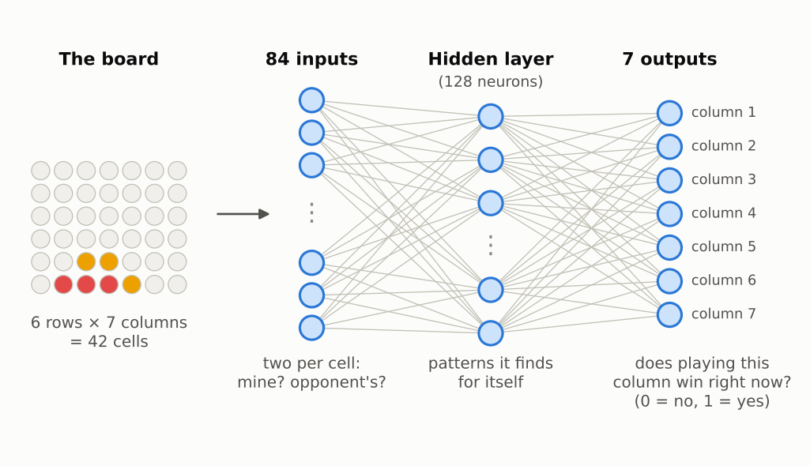

# Start here: the big picture

No maths on this page. It covers what a neural network is, what it looks like, how it learns, the words you'll meet, and how to read the charts. The pages after this one build on it.

---

## What problem does a neural network solve?

Your FYP bot had to answer one question over and over: *"How good is this board for me?"*

It answered with a **lookup table**: one stored score for every board it had seen. That has two problems. It needs gigabytes, and it has no answer at all for a board it has never seen.

A neural network answers the same question with a **formula** instead of a table. A board goes in, a score comes out. The formula has thousands of adjustable numbers inside it, and **training** is the process that sets those numbers.

Think of it as a machine covered in dials:

- At first the dials are set randomly, so the answers are rubbish.
- Training turns the dials, a tiny bit at a time, until the answers come out right.
- Because it's a formula and not a table, it gives an answer for any board, including boards it has never seen. And a few thousand dials take up kilobytes, not gigabytes.

## What a network looks like

- **Each circle is a neuron.** A neuron does one tiny calculation: it takes some numbers in and gives one number out.
- **Each line is a connection.** Every connection has its own **weight**, which is one of the dials. It sets how much the next neuron listens to that input, and whether it counts *for* or *against*.
- **Information flows left to right.** The facts go in on the left (for us, the board). The answer comes out on the right.
- **Each column of neurons is a layer.** The middle layer is called **hidden** only because you never see its numbers directly. It's the network's working notes.

**Analogy: a small company.**
- The **inputs** are the raw facts.
- The **hidden layer** is a team of analysts. Each one looks at all the facts but pays attention to different ones (that's their dials), and writes a one-number summary.
- The **output** is the boss. The boss reads the summaries, trusts some analysts more than others (more dials), and makes the final call.
- Nobody tells the analysts what to look for. Training discovers it.

## What one neuron does

Zoom in on one circle. A neuron works like a judge weighing evidence:

1. Look at each piece of evidence (each **input**).
2. Multiply each one by how much you trust it (its **weight**). Trust can be negative: "this counts *against*".
3. Add everything up, plus your own starting lean (the **bias**).
4. Turn the total into a confidence between 0 and 1 with the **squash function**. 0 means "definitely no", 1 means "definitely yes", 0.5 means "no idea". That's the same idea as the 0-100 scores in your FYP.

That's all a neuron does. Every neuron in every network does just this. The power comes from connecting many of them, and from setting the dials well.

## What is a "guess"?

You put an input into the network, the numbers flow through it, and a number comes out the other end. That output is the network's **guess** (textbook: *prediction*).

For example, a board goes in, and out comes "0.9 for column 1": the network's guess that playing column 1 wins.

It's called a guess because at the start the dials are random, so the output really is a random guess. Training makes the guesses better and better, but even a well-trained network is still estimating; it isn't looking anything up.

## Where do the right answers come from?

To know a guess is wrong, you need the right answer to compare it with. **During training, every input must come with its right answer already known.** In the flashcard picture, someone has to write the answer on the back of every card. (Textbooks call this *supervised learning*, and the answers *labels*.)

There are three common places the right answers come from:

1. **A rule a computer can already check.** In step 4, the input is a Connect 4 board and the right answer is "which columns win right now". The game engine from stage 1 finds that exactly: it tries each column and checks for four in a row. So we can make as many cards as we like, all with correct answers.

   *Why train a network if the computer already knows the rule?* Because it's practice with answers we can trust completely. The interesting part is whether the network can work the rule out from examples alone, without ever being told it.

2. **People write the answers.** For example, thousands of photos labelled "cat" or "dog" by hand, or emails people marked as spam.

3. **Wait and see what happens.** In stage 4, nobody knows the right answer to "how good is this board?". But you can play the game to the end and see who won. The result (win = 1, loss = 0, draw = 0.5) becomes the right answer for the boards in that game. **That is exactly what your FYP did.** The bots made their own flashcards by playing each other. (Textbooks call this *reinforcement learning*.)

In pages 1 and 2 the cards are tiny made-up examples, and we wrote the answers ourselves.

### After training, there's no answer to compare with

Once a network is trained, you use it on new inputs where you **don't** know the answer. That's the whole point.

So how do you know you can trust it? Before you start, set aside some cards with known answers and never let the network practise on them. After training, test it on those, like an exam with questions the student hasn't seen. If it gets those right, it has learned the rule rather than memorised the cards.

## How a network learns: flashcards

Training is like studying with flashcards:

1. Each card has a **question** on the front (the inputs, e.g. a board) and the **right answer** on the back (e.g. "column 1 wins").
2. The network reads the front and makes a **guess**.
3. Flip the card and measure **how far off** the guess was. That's the **error**.
4. Turn every dial a tiny bit in the direction that would have made the guess less wrong.
5. Next card. Repeat thousands of times.

Step 4 is the clever part: with thousands of dials, how do you know which way to turn each one? Pages 1 to 3 are about exactly that.

**Analogy for step 4: walking downhill in fog.** You're on a hillside in thick fog and want to reach the bottom. You can't see the valley, but you can feel which way the ground tilts under your feet. So you take a small step downhill, feel again, step again. Here, "height" is the error and "downhill" means less wrong. That tilt is called the **slope**.

## The Connect 4 network we'll build (step 4)

- **42 inputs**, one for each cell of the board.
- **A hidden layer** that finds useful patterns by itself, like "three in a row with a gap".
- **7 outputs**, one per column, each answering: *"if I play here, do I win right now?"*

In the board drawn above, red is to move and can win by playing column 1. A well-trained network should answer close to 1 for column 1 and close to 0 for the others.

The flashcards come from random Connect 4 positions. The game engine from stage 1 already knows the right answer for any board, so we can make as many cards as we like.

Before that, pages 1 and 2 look at a single neuron, and page 3 wires neurons together.

## Words you'll meet

You don't need to memorise these. Come back here whenever a word is unclear.

| Word | Plain meaning |
|---|---|
| **Neural network** (or ANN, artificial neural network) | A formula made of many small, simple parts (neurons) connected together. Its behaviour is set by adjustable numbers (weights). |
| **Neuron** (also "node" or "unit") | One small part: takes numbers in, multiplies each by a weight, adds them up, squashes the total, gives one number out. |
| **Input** | A number fed into the network or a neuron, e.g. one board cell. |
| **Weight** | A dial on a connection: how much to listen to that input, and whether it counts for or against. |
| **Bias** | A neuron's starting lean, before it looks at any input. Also a dial. |
| **Squash function** (textbook: **sigmoid**, a kind of **activation function**) | Turns any number into a confidence between 0 and 1. |
| **Output / guess / prediction** | The number that comes out when you put an input in. It's the network's answer, which may be right or wrong. |
| **Layer** | A column of neurons. Inputs on the left, output on the right, hidden layers in between. |
| **Hidden layer** | A layer in the middle. "Hidden" just means you don't see its numbers directly. |
| **Example / flashcard** (textbook: **training example**) | One question with its right answer. |
| **Answer** (textbook: **target** or **label**) | The right answer on the back of the card. It must be known before training, from a rule, from people, or from what happened (e.g. who won). |
| **Supervised learning** | Learning from cards whose right answers are already known. Steps 1 to 4 of stage 2. |
| **Reinforcement learning** | Learning where the answers come from what happens later, e.g. playing to the end and seeing who won. Your FYP, and stage 4. |
| **Test cards** (textbook: **test set**) | Cards with known answers that the network never practises on, kept back to check it at the end, like an exam. |
| **Error** (textbook: **loss**) | How far off a guess was. **Nothing to do with losing a game.** 0 means exactly right. These notes say "error". |
| **Slope** (textbook: **gradient**) | For one dial: if you turn it up a little, does the error go up or down, and how much? Tells you which way is downhill. |
| **Gradient descent** | Turn every dial a small step downhill, then repeat. This is how networks learn. |
| **Step size** (textbook: **learning rate**) | How far you turn the dials each time. |
| **Training round** (textbook: **training step**, sometimes **epoch**) | One cycle of: guess, measure the error, turn the dials. |
| **Training** | Doing training rounds over and over until the error is small. |
| **Forward pass** | Making a guess: numbers flow forward, from inputs to output. |
| **Backpropagation** (or **backward pass**) | Working out every dial's slope by passing the blame backwards, from the output to the inputs. Page 3a. |
| **Blame** (textbook: **error signal** or **delta**) | For one neuron: how much the error would change if that neuron's total went up a little. Negative means its total should go up. Page 3a. |
| **Gradient check** | Checking backpropagation's slopes against the slow nudge test, to catch bugs in the code. Page 3a. |
| **Matrix** | A grid of numbers. A layer keeps its weights in one, with a column per neuron, so the same code works for any number of neurons. |
| **Local minimum** | A hollow in the error landscape that isn't the lowest point. Every small step from there goes uphill, so training gets stuck. Page 3b. |
| **Chain rule** | The rule backpropagation uses: when one thing turns another, which turns another, multiply the "gear ratios" to see how the first affects the last. Page 1, section 8. |
| **Generalising** | Getting the right answer for questions the network never practised on. The thing your FYP table couldn't do. |

## How to read the charts in these notes

The pages use four kinds of chart.

**Learning curve.** The most common chart in machine learning.
- Across the bottom: **training rounds**, i.e. how much practice so far.
- Up the side: **average error**, i.e. how wrong the guesses are. Lower is better.
- A healthy learning curve drops steeply at first, then flattens out. Big, easy improvements come first, then slow fine-tuning, much like learning a new skill. The shape looks like a mathematical curve, but it isn't a formula. It's simply a record of the error after each round.

**Dial chart.**
- Same bottom axis (training rounds).
- Up the side: the value of each dial.
- Shows the dials moving during training and settling into place.

**Error landscape.** The "hill" from the fog analogy, drawn from the side.
- Across the bottom: every possible setting of one dial.
- Up the side: the error you'd get with the dial at that setting.
- A dot marks where the dial is now. The lowest point of the curve is where you want to end up.

**Colour map.**
- Shows the network's answer for every possible input at once.
- The colour shows the answer: red for "no" (near 0), blue for "yes" (near 1), pale for "not sure" (near 0.5).
- Dots mark the flashcards, labelled with the right answer and what the network actually said.

---

**Next:** [Step 1: One neuron, by hand](01-one-neuron-by-hand.md)
