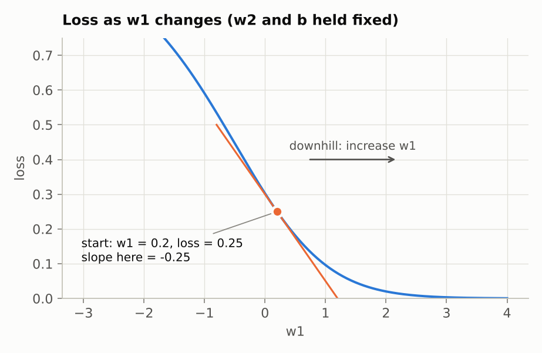

# Step 1: One neuron, by hand

**Goal:** see exactly how one training step adjusts the weights, using numbers small enough to check on paper.

**Code:** [`src/connect4/numpy_nn/neuron.py`](../../src/connect4/numpy_nn/neuron.py). Run `python -m connect4.numpy_nn.neuron` to print every number on this page.

---

## 1. What a neuron is

A neuron takes some numbers in and gives one number out.

```
input x1 ── × w1 ──┐
                   ├──► z = w1·x1 + w2·x2 + b ──► sigmoid(z) ──► prediction (0 to 1)
input x2 ── × w2 ──┘
```

- Each input is multiplied by a **weight**. The weight says how much that input matters, and which way it pushes: a positive weight pushes the output up, a negative weight pushes it down.
- The results are added up, plus a **bias** `b`. The bias is the neuron's lean before it sees any input.
- The total, `z`, can be any number. The **sigmoid** function squashes it into the range 0 to 1:

```
z:            -4     -2      0      2      4
sigmoid(z):  0.02   0.12   0.50   0.88   0.98
```

The weights and the bias are the only things that change during training. Everything the neuron "knows" is stored in those few numbers.

Compare this with your FYP: there, knowledge was one stored score per board position. In a neural network it is stored in the weights, and the same weights are used for every input. That is why a network can give an answer for an input it has never seen.

A **network** is many neurons wired together, where the outputs of one layer become the inputs of the next. Step 3 builds that. This page sticks to a single neuron.

## 2. The example

One training example: two inputs, and the answer we want the neuron to give.

| | value |
|---|---|
| input `x1` | 1.0 |
| input `x2` | 0.5 |
| target (the right answer) | 1 |

The neuron starts with these weights. Normally they start random; these are picked to keep the arithmetic easy.

| | value |
|---|---|
| `w1` | 0.2 |
| `w2` | -0.4 |
| `b` | 0 |

## 3. Make a prediction (the "forward pass")

```
z = w1 × x1 + w2 × x2 + b
  = 0.2 × 1.0 + (-0.4) × 0.5 + 0
  = 0.2 - 0.2
  = 0

prediction = sigmoid(0) = 0.5
```

The neuron says 0.5, meaning it has no idea. We wanted 1.

## 4. Measure how wrong it is (the "loss")

```
loss = (prediction - target)²
     = (0.5 - 1)²
     = 0.25
```

The loss is a single number for "how wrong". Squaring makes it always positive, and makes big misses count much more than small ones. A loss of 0 means a perfect prediction.

**Training means changing the weights to make the loss smaller.** The question is which way to change each one.

## 5. Which way should each weight move? The nudge test

For each weight, ask: *if I nudge it up a little, does the loss go up or down, and by how much?*

Try it on `w1`. Nudge it from 0.2 to 0.201, keep everything else the same, and redo steps 3 and 4:

```
z          = 0.201 × 1.0 + (-0.4) × 0.5 + 0  = 0.001
prediction = sigmoid(0.001)                  = 0.50025
loss       = (0.50025 - 1)²                  = 0.24975
```

The loss went from 0.25000 down to 0.24975, a change of -0.00025, for a nudge of +0.001:

```
slope of w1 = change in loss / size of nudge
            = -0.00025 / 0.001
            = -0.25
```

The same test for the other two:

| | nudge | loss after | slope |
|---|---|---|---|
| `w1` | 0.2 → 0.201 | 0.24975 | -0.25 |
| `w2` | -0.4 → -0.399 | 0.249875 | -0.125 |
| `b` | 0 → 0.001 | 0.24975 | -0.25 |

This slope is called the **gradient**. How to read it:

- **The sign gives the direction.** Negative means increasing this weight lowers the loss, so increase it. Positive means decrease it.
- **The size says how much this weight matters right now.** `w2`'s slope is half of `w1`'s because its input (0.5) is half of `w1`'s input (1.0), so `w2` has less effect on `z`.



The blue curve is the loss for every possible value of `w1`, with `w2` and `b` held fixed. The orange line is the slope at the starting point (`w1 = 0.2`). It tilts down to the right, so moving right (increasing `w1`) goes downhill. Training is walking downhill on curves like this one, for every weight at once.

## 6. Take a step downhill (gradient descent)

Move every weight a small step in the opposite direction to its slope:

```
new weight = old weight - learning rate × slope
```

The **learning rate** sets the size of the step. Here it is 1:

```
w1 = 0.2  - 1 × (-0.25)  = 0.45
w2 = -0.4 - 1 × (-0.125) = -0.275
b  = 0    - 1 × (-0.25)  = 0.25
```

Check whether that helped, by redoing the prediction with the new weights:

```
z          = 0.45 × 1.0 + (-0.275) × 0.5 + 0.25 = 0.5625
prediction = sigmoid(0.5625)                    = 0.637
loss       = (0.637 - 1)²                       = 0.132
```

The prediction moved from 0.5 toward 1, and the loss nearly halved, from 0.25 to 0.132. That is one step of training. This method is called **gradient descent**: find the slopes (gradients), step downhill (descent).

## 7. Repeat

The same four moves again and again. This is the output of `python -m connect4.numpy_nn.neuron`:

```
 step     w1      w2      b    prediction   loss
   0   0.200  -0.400   0.000    0.500     0.2500
   1   0.450  -0.275   0.250    0.637     0.1317
   2   0.618  -0.191   0.418    0.719     0.0789
   3   0.731  -0.134   0.531    0.768     0.0540
   4   0.814  -0.093   0.614    0.799     0.0403
   5   0.879  -0.061   0.679    0.822     0.0319
   6   0.931  -0.035   0.731    0.838     0.0262
   7   0.975  -0.013   0.775    0.851     0.0222
   8   1.013   0.006   0.813    0.862     0.0192
   9   1.046   0.023   0.846    0.870     0.0169
  10   1.075   0.037   0.875    0.877     0.0150
```

Each step is smaller than the one before. As the prediction gets closer to 1 the slopes shrink, so the steps shrink too. Training is fast at first and slows down as it closes in on the answer.

## 8. The shortcut: the chain rule

The nudge test works, but it costs one extra prediction for every weight. With 3 weights that's fine. The network in stage 4 will have tens of thousands of weights and train for millions of steps, so nudging each weight one at a time would be far too slow.

Calculus gives the exact slope without any nudging. The loss depends on `w1` through a chain of simple steps:

```
w1  ──►  z  ──►  prediction  ──►  loss
```

Each link has its own easy slope, and the **chain rule** says the slope of the whole chain is the link slopes multiplied together:

| Link | Its slope | Value here | What it means |
|---|---|---|---|
| prediction → loss | `2 × (prediction - target)` | 2 × (0.5 - 1) = **-1** | how wrong the prediction is, and in which direction |
| z → prediction | `prediction × (1 - prediction)` | 0.5 × 0.5 = **0.25** | how strongly the sigmoid responds at this point |
| w1 → z | `x1` | **1.0** | how big the input attached to this weight is |

```
slope of w1 = -1 × 0.25 × 1.0 = -0.25     (nudge test: -0.25 ✓)
slope of w2 = -1 × 0.25 × 0.5 = -0.125    (nudge test: -0.125 ✓)
slope of b  = -1 × 0.25 × 1   = -0.25     (nudge test: -0.25 ✓)
```

For `b` the last link is 1, because the bias is added straight into `z`, like an input that is always 1.

Where do the link slopes come from? They are standard results: the slope of `(p - t)²` is `2(p - t)`, the slope of the sigmoid is `sigmoid × (1 - sigmoid)`, and in `z = w1·x1 + ...`, increasing `w1` by 1 increases `z` by `x1`. You don't need to derive them yourself; the nudge test confirms each one. The two methods agree, which is exactly what the program prints first:

```
Slopes at the start, two ways:
  by nudging 0.001:  w1 -0.2499  w2 -0.1250  b -0.2499
  by chain rule:     w1 -0.2500  w2 -0.1250  b -0.2500
```

(The nudge test is a tiny bit off because the curve bends slightly within the nudge. The chain rule is exact.)

### What the three factors tell you

This is the answer to "how does adjusting the weights work". Each weight's change is the product of three things:

1. **How wrong the prediction was.** If the prediction is already right, this factor is 0 and nothing changes. Networks only learn from mistakes.
2. **How responsive the neuron is.** Near 0 or 1 the sigmoid is almost flat, this factor is close to 0, and learning stalls. Step 2 shows this going badly wrong.
3. **How big the input was.** A weight attached to an input of 0 gets a slope of 0: it played no part in the mistake, so it isn't changed. Blame is shared out according to how much each weight contributed.

## 9. In code

The chain rule version, from `neuron.py`:

```python
def gradients(weights, bias, x, target):
    z = np.dot(weights, x) + bias
    prediction = sigmoid(z)

    dloss_dprediction = 2 * (prediction - target)  # how wrong, and in which direction
    dprediction_dz = prediction * (1 - prediction)  # how strongly the sigmoid responds here
    dloss_dz = dloss_dprediction * dprediction_dz

    # z = w1*x1 + w2*x2 + b, so nudging weight i changes z by x_i, and nudging b changes z by 1.
    weight_slopes = dloss_dz * np.asarray(x, dtype=float)
    bias_slope = dloss_dz
    return weight_slopes, bias_slope
```

`dloss_dz` is the usual way to write "the slope of the loss with respect to z". The `d` comes from calculus notation.

And one training step:

```python
def train_step(weights, bias, x, target, learning_rate):
    weight_slopes, bias_slope = gradients(weights, bias, x, target)
    new_weights = weights - learning_rate * weight_slopes
    new_bias = bias - learning_rate * bias_slope
    return new_weights, new_bias
```

## Summary

Training a neuron is a loop of four moves:

1. **Predict:** the forward pass.
2. **Measure the error:** the loss.
3. **Find each weight's slope:** the gradient.
4. **Step each weight downhill:** gradient descent.

Every neural network, including the ones in stages 3 to 5, trains with this loop. What changes is how many neurons there are, and how the slopes are worked out through many layers. That method is **backpropagation**, which is the chain rule above applied link by link back through the network (step 3).

## Try it yourself

Open a Python shell in the project (`python`) and paste:

```python
import numpy as np
from connect4.numpy_nn.neuron import predict, train_step

weights, bias = np.array([0.2, -0.4]), 0.0
x = np.array([1.0, 0.5])

for step in range(5):
    weights, bias = train_step(weights, bias, x, target=0.0, learning_rate=1.0)
    print(weights, bias, predict(weights, bias, x))
```

Things to try, and to predict before you run them:

- With `target=0.0`, which way do the weights move?
- Set `x = np.array([1.0, 0.0])`. Does `w2` change at all? Why not?
- Try `learning_rate=10.0`, then `100.0`. What happens to the prediction?

---

**Next:** [Step 2: Training a neuron on many examples](02-training-a-neuron.md)
