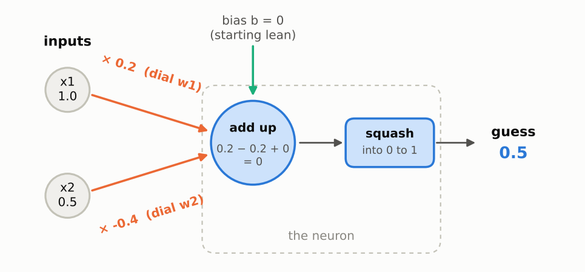
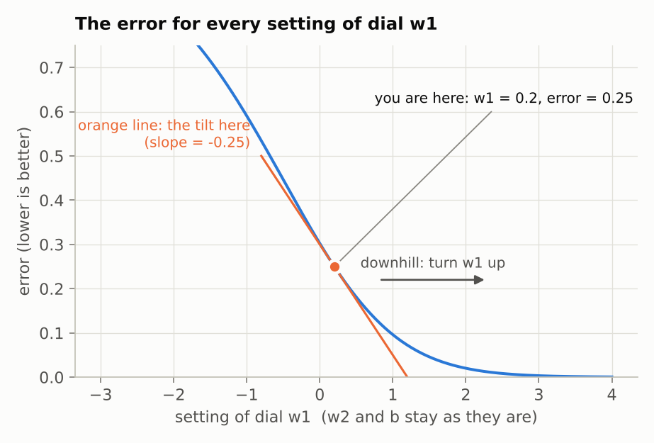

# Step 1: One neuron, by hand

**Read first:** [Start here: the big picture](00-start-here.md). It explains the words used below.

**Goal:** watch one neuron make a guess, measure how wrong it is, and turn its dials once, using numbers you can check with a calculator.

**Code:** [`src/connect4/numpy_nn/neuron.py`](../../src/connect4/numpy_nn/neuron.py). Run `python -m connect4.numpy_nn.neuron` to print every number on this page.

---

## 1. The neuron



Reading the picture from left to right:

1. **Two inputs** come in: `x1 = 1.0` and `x2 = 0.5`.
2. Each is multiplied by its **dial** (weight): `w1 = 0.2` and `w2 = -0.4`.
3. The neuron **adds them up**, plus its starting lean, the **bias** `b = 0`.
4. The total is **squashed** into a number between 0 and 1. That's the neuron's **guess**.

The squash function turns any total into a confidence:

| Total going in | -4 | -2 | 0 | 2 | 4 |
|---|---|---|---|---|---|
| **Confidence coming out** | 0.02 | 0.12 | 0.50 | 0.88 | 0.98 |

Big positive totals come out near 1 ("yes"). Big negative totals come out near 0 ("no"). A total of 0 comes out as 0.5 ("no idea").

The dials (`w1`, `w2`) and the bias (`b`) are the only things that change during training. Everything the neuron "knows" lives in those three numbers.

## 2. The flashcard

One flashcard to learn from:

- **Front (the inputs):** 1.0 and 0.5
- **Back (the right answer):** 1, meaning "yes"

These are made-up numbers, chosen so the arithmetic is easy. The point is to see the mechanics. Connect 4 comes in step 4.

The dials start at `w1 = 0.2`, `w2 = -0.4`, `b = 0`. Normally they start random; these were picked to keep the sums simple.

## 3. Step A: make a guess

```
total = w1 × x1 + w2 × x2 + b
      = 0.2 × 1.0 + (-0.4) × 0.5 + 0
      = 0.2 - 0.2
      = 0

guess = squash(0) = 0.5
```

The neuron says 0.5: "no idea". The right answer is 1.

## 4. Step B: how wrong was it? (the error)

```
error = (guess - answer)²
      = (0.5 - 1)²
      = 0.25
```

**The error is a score for how wrong the guess was.** 0 means exactly right; bigger means more wrong. (Textbooks call it the *loss*. It has nothing to do with losing a game.)

Why square the difference?
- It makes the error positive whether the guess was too high or too low. Both are wrong.
- It makes big misses count much more than small ones. A miss of 0.5 scores 0.25, but a miss of 0.1 scores only 0.01.

**The whole goal of training is to make this number smaller.** The question is which way to turn each dial.

## 5. Step C: which way should each dial turn? (the nudge test)

**Analogy:** tuning an old radio. You turn the knob a hair and listen. Is the static better or worse? That tells you which way to keep turning.

Do the same with `w1`. Turn it up a hair, from 0.2 to 0.201, keep everything else the same, and redo the guess and the error:

```
total = 0.201 × 1.0 + (-0.4) × 0.5 + 0  = 0.001
guess = squash(0.001)                   = 0.50025
error = (0.50025 - 1)²                  = 0.24975
```

The error dropped from 0.25000 to 0.24975, a change of -0.00025, from a nudge of 0.001. Divide one by the other:

```
slope of w1 = change in error ÷ size of nudge
            = -0.00025 ÷ 0.001
            = -0.25
```

That number is the **slope**. Doing the same test on all three:

| Dial | Nudge | Error after | Slope |
|---|---|---|---|
| `w1` | 0.2 → 0.201 | 0.24975 | -0.25 |
| `w2` | -0.4 → -0.399 | 0.249875 | -0.125 |
| `b` | 0 → 0.001 | 0.24975 | -0.25 |

**How to read a slope:**
- **The sign gives the direction.** Negative means turning this dial *up* makes the error *smaller*, so turn it up. Positive means turn it down.
- **The size says how much this dial matters right now.** `w2`'s slope is half of `w1`'s because `w2`'s input (0.5) is half of `w1`'s input (1.0), so `w2` has less effect on the total.

### The same thing as a picture



**How to read this chart.** This is the hillside from the fog analogy, seen from the side.
- **Across the bottom:** every possible setting of dial `w1`. The other dials stay where they are.
- **Up the side:** the error you would get with `w1` at that setting. Lower is better.
- **The blue curve** is the ground.
- **The orange dot** is where `w1` is now: setting 0.2, error 0.25.
- **The orange line** is the tilt of the ground right at the dot, i.e. the slope of -0.25. It slopes down to the right.

So moving right (turning `w1` up) is downhill. If you could see the whole curve, you'd see the error keeps falling as `w1` goes up. But the neuron can't see the whole curve; it can only feel the tilt where it's standing. That's why it takes small steps.

## 6. Step D: turn the dials (one step downhill)

Turn every dial a small step **against** its slope:

```
new dial = old dial - step size × slope
```

Why the minus sign? The slope points the way the error *increases*, which is uphill. We want to go the other way.

The **step size** (textbook: *learning rate*) controls how far to turn. Here it's 1:

```
w1 = 0.2  - 1 × (-0.25)  = 0.45
w2 = -0.4 - 1 × (-0.125) = -0.275
b  = 0    - 1 × (-0.25)  = 0.25
```

Did it help? Make the guess again with the new dials:

```
total = 0.45 × 1.0 + (-0.275) × 0.5 + 0.25 = 0.5625
guess = squash(0.5625)                     = 0.637
error = (0.637 - 1)²                       = 0.132
```

The guess moved from 0.5 toward the right answer of 1, and the error nearly halved, from 0.25 to 0.132. **That is one round of training.** This method is called **gradient descent**: find the slopes, step downhill.

## 7. Repeat

The same four steps, ten times over. This is the output of `python -m connect4.numpy_nn.neuron`:

```
 round    w1      w2      b      guess    error
    0   0.200  -0.400   0.000    0.500    0.2500
    1   0.450  -0.275   0.250    0.637    0.1317
    2   0.618  -0.191   0.418    0.719    0.0789
    3   0.731  -0.134   0.531    0.768    0.0540
    4   0.814  -0.093   0.614    0.799    0.0403
    5   0.879  -0.061   0.679    0.822    0.0319
    6   0.931  -0.035   0.731    0.838    0.0262
    7   0.975  -0.013   0.775    0.851    0.0222
    8   1.013   0.006   0.813    0.862    0.0192
    9   1.046   0.023   0.846    0.870    0.0169
   10   1.075   0.037   0.875    0.877    0.0150
```

Things to notice:
- The **guess** climbs toward 1 every round.
- The **error** falls every round.
- The steps get **smaller** each round. As the guess gets closer to the answer the slopes shrink, so the dials move less. Training is fast at first and slows down as it closes in.

## 8. The shortcut: gear ratios (the chain rule)

The nudge test works, but it costs one extra guess for every dial. With 3 dials that's fine. The stage 4 network will have tens of thousands of dials and train for millions of rounds, so nudging each dial one at a time would be far too slow.

There's a shortcut that gives the exact slope of every dial in one go.

**Analogy: a chain of gears.** Turning dial `w1` turns the *total*, which turns the *guess*, which turns the *error*:

```
w1  ──►  total  ──►  guess  ──►  error
```

If you know the gear ratio of each pair (how much the next one turns when this one turns), you can multiply them together to get how much the last gear turns when you turn the first. No experiment needed.

The three gear ratios, right now:

| Gear pair | Ratio here | Plain meaning |
|---|---|---|
| `w1` → total | **1.0** (the input `x1`) | The dial's effect is scaled by the input it's attached to |
| total → guess | **0.25** | How responsive the squash function is at this point |
| guess → error | **-1** | How wrong the guess is, and in which direction |

Multiply them:

```
slope of w1 = 1.0 × 0.25 × (-1) = -0.25     (nudge test said -0.25 ✓)
slope of w2 = 0.5 × 0.25 × (-1) = -0.125    (nudge test said -0.125 ✓)
slope of b  = 1   × 0.25 × (-1) = -0.25     (nudge test said -0.25 ✓)
```

For `w2`, the first ratio is its own input, 0.5. For the bias it's 1, because the bias is added straight into the total.

In textbooks, multiplying gear ratios along a chain is called the **chain rule**. Each ratio comes from a short formula, shown in the code below; you don't need to derive them. The program checks that both methods agree:

```
Slopes at the start, two ways:
  by nudging 0.001:  w1 -0.2499  w2 -0.1250  b -0.2499
  by gear ratios:    w1 -0.2500  w2 -0.1250  b -0.2500
```

(The nudge test is a hair off because the curve bends slightly within the nudge. The gear-ratio method is exact.)

### What the three ratios say about how the dials get adjusted

This is the heart of how a network learns. How much each dial is turned depends on three things multiplied together:

1. **How wrong the guess was.** If the guess is already right, this is 0 and nothing changes. The network only learns from its mistakes.
2. **How responsive the neuron is.** When the squash function is already near 0 or 1, it's almost flat, this ratio is close to 0, and learning stalls. Step 2 shows this going badly wrong.
3. **How big the dial's input was.** A dial attached to an input of 0 gets a slope of 0. It played no part in the mistake, so it isn't changed.

**Analogy: a group project that went wrong.** The correction is shared out according to who contributed. Someone who did a lot gets a big correction, someone who did a little gets a small one, and someone who wasn't involved (input 0) gets none.

## 9. In code

The gear-ratio method, from `neuron.py`:

```python
def slopes(weights, bias, x, answer):
    total = np.dot(weights, x) + bias
    guess = sigmoid(total)

    # Ratio 1: how much the error moves when the guess moves. Says how wrong, and which way.
    error_per_guess = 2 * (guess - answer)
    # Ratio 2: how much the guess moves when the total moves. Says how responsive the squash is.
    guess_per_total = guess * (1 - guess)
    error_per_total = error_per_guess * guess_per_total

    # Ratio 3: total = w1*x1 + w2*x2 + b, so turning weight i moves the total by x_i,
    # and turning the bias moves it by 1.
    weight_slopes = error_per_total * np.asarray(x, dtype=float)
    bias_slope = error_per_total
    return weight_slopes, bias_slope
```

`np.dot(weights, x)` is NumPy's way of writing `w1×x1 + w2×x2`. `sigmoid` is the squash function.

And one round of training:

```python
def train_step(weights, bias, x, answer, learning_rate):
    weight_slopes, bias_slope = slopes(weights, bias, x, answer)
    new_weights = weights - learning_rate * weight_slopes
    new_bias = bias - learning_rate * bias_slope
    return new_weights, new_bias
```

## Summary

Training a neuron is a loop of four steps:

1. **Guess:** multiply inputs by dials, add up, squash.
2. **Measure the error:** how far off was the guess?
3. **Find each dial's slope:** which way is downhill for that dial?
4. **Turn each dial a small step downhill.**

Every neural network, including the ones in stages 3 to 5, learns with this same loop. Bigger networks just have more dials, and work out the slopes by passing the gear ratios back through every layer (backpropagation, page 3).

## Try it yourself

Open Python in the project folder (type `python`) and paste:

```python
import numpy as np
from connect4.numpy_nn.neuron import predict, train_step

weights, bias = np.array([0.2, -0.4]), 0.0
x = np.array([1.0, 0.5])

for round_number in range(5):
    weights, bias = train_step(weights, bias, x, answer=0.0, learning_rate=1.0)
    print(weights, bias, predict(weights, bias, x))
```

This time the right answer is 0 ("no"). Before running each one, guess what will happen:

- Which way do the dials move now?
- Change `x` to `np.array([1.0, 0.0])`. Does `w2` change at all? Why not?
- Try `learning_rate=10.0`. How many rounds does it take to get close to 0?

---

**Previous:** [Start here](00-start-here.md) · **Next:** [Step 2: Training a neuron on many examples](02-training-a-neuron.md)
