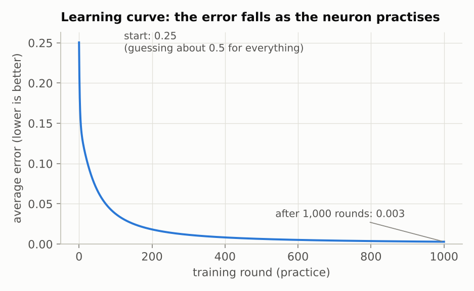
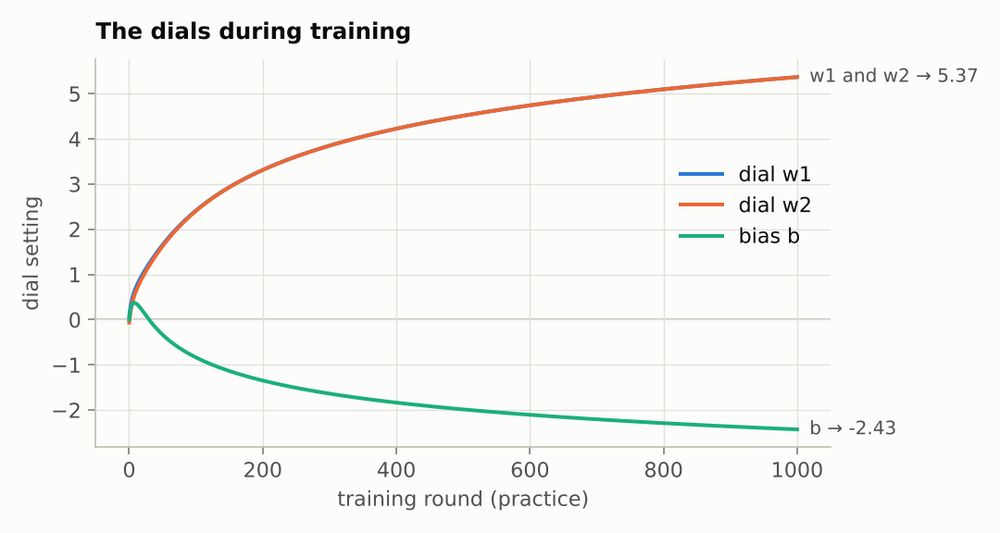
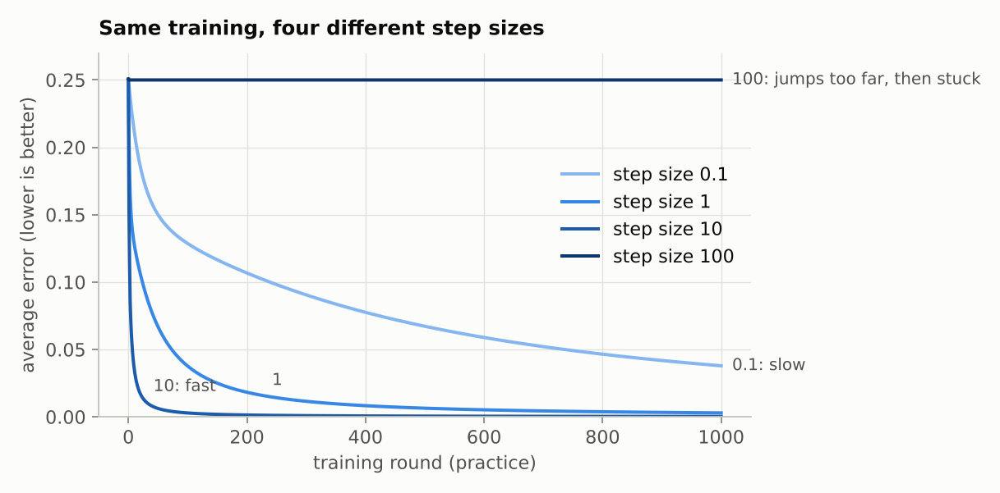

# Step 2: Training a neuron on many examples

**Read first:** [Start here](00-start-here.md) and [Step 1](01-one-neuron-by-hand.md).

**Goal:** go from one flashcard to a whole deck, watch the dials settle over many rounds, see what the step size does, and find something one neuron can't learn.

**Code:** `train()` in [`src/connect4/numpy_nn/neuron.py`](../../src/connect4/numpy_nn/neuron.py). The charts come from [`scripts/make_stage2_charts.py`](../../scripts/make_stage2_charts.py).

---

## 1. The deck of flashcards: OR

Each card has two inputs that are either off (0) or on (1). The right answer follows a rule called **OR**: "1 if either input is on".

| Input 1 | Input 2 | Right answer |
|---|---|---|
| 0 | 0 | 0 |
| 0 | 1 | 1 |
| 1 | 0 | 1 |
| 1 | 1 | 1 |

That's the whole deck: 4 cards. The neuron isn't told the rule; it only sees the cards. Can it work the rule out?

Why such a tiny problem? So you can see everything: 4 cards, 3 dials. The Connect 4 version (step 4) works exactly the same way, just with more cards and more dials.

## 2. Many cards: let every card vote

In step 1 there was one card, and each round turned the dials to fix it. Now there are four, and they disagree: card `(0, 0)` wants the guess pushed **down**, the other three want it pushed **up**. Turning the dials to fix one card could make the others worse.

So each round:
1. Work out the slopes for **every** card, as in step 1.
2. **Average** them.
3. Take one step using the average.

Every card gets a vote, and the dials move in the direction that helps the most cards the most.

In code (from `train()`):

```python
for round_number in range(rounds):
    total_weight_slopes = np.zeros_like(weights)
    total_bias_slope = 0.0
    for x, answer in zip(inputs, answers):  # for every card...
        weight_slopes, bias_slope = slopes(weights, bias, x, answer)  # ...step 1's slopes
        total_weight_slopes += weight_slopes
        total_bias_slope += bias_slope

    # average the votes, then take one step downhill
    weights = weights - learning_rate * total_weight_slopes / len(inputs)
    bias = bias - learning_rate * total_bias_slope / len(inputs)
```

The dials start as small random numbers (here `w1 = 0.06`, `w2 = -0.07`, `b = 0`), so at first every guess is about 0.5: no idea.

## 3. Watching it learn

The neuron's guesses before training and after 1,000 rounds (step size 1):

| Input 1 | Input 2 | Right answer | Guess before | Guess after |
|---|---|---|---|---|
| 0 | 0 | 0 | 0.500 | 0.081 |
| 0 | 1 | 1 | 0.483 | 0.950 |
| 1 | 0 | 1 | 0.516 | 0.950 |
| 1 | 1 | 1 | 0.499 | 1.000 |

It worked it out: close to 0 where the answer is 0, close to 1 where the answer is 1.

### The learning curve



**How to read this chart:**
- **Across the bottom:** training rounds, i.e. how much practice so far.
- **Up the side:** the average error over the 4 cards. Lower is better.

The error starts at 0.25, when the neuron is guessing about 0.5 for everything. It falls steeply at first, then more and more slowly: 0.21 after 1 round, 0.13 after 10, 0.038 after 100, and 0.003 after 1,000.

Why that shape? Early on the guesses are far off, the slopes are steep, and each step makes a big difference. As the guesses get close, the slopes flatten and the steps shrink. It's like learning a new skill: rapid progress at first, then slow polishing.

### The dials



**How to read this chart:**
- **Across the bottom:** training rounds, as before.
- **Up the side:** the setting of each dial. Blue and orange are the two weights, green is the bias.

What happened:
- **`w1` and `w2` rise together to 5.37.** The blue line is hidden under the orange one because they end up identical. That's because OR treats both inputs the same way. Nobody told the neuron this; it found it in the cards.
- **The bias goes up briefly, then sinks to -2.43.** At first, three of the four cards want the guess higher, so everything goes up, the bias included. Once the two weights have taken over the job of pushing the guess up, the bias's job becomes holding card `(0, 0)` down.

The finished dials can be read as a rule:

```
both inputs off:  total = -2.43                      → squash → 0.08  (no)
one input on:     total = 5.37 - 2.43        = 2.94  → squash → 0.95  (yes)
both inputs on:   total = 5.37 + 5.37 - 2.43 = 8.31  → squash → 1.00  (yes)
```

The bias holds the answer at "no" until at least one input switches on. That is the OR rule, stored in three numbers.

The guesses never reach exactly 0 or 1. The dials keep creeping outwards and the error keeps creeping down for as long as you train. In practice you stop when it's good enough.

## 4. The step size

How far should the dials turn each round? Here is the same training with four different step sizes:



**How to read this chart:** four learning curves on one chart, one per step size. Darker blue means a bigger step.

- **0.1, small steps:** steady but slow. After 1,000 rounds it has only reached where step size 1 was after 100.
- **1 and 10:** faster.
- **100, giant steps:** the error never moves from 0.25. The flat line at the top.

**What went wrong with 100?** Think back to walking downhill in fog. With giant strides, the very first step flings you right off the hillside onto a huge flat plain. On flat ground you can't feel any tilt, so you don't know which way to go, and you never move again.

In numbers: the first step turns all three dials up to about 12.5. Now the neuron's total is huge for every card, so it squashes to 1.00 for all of them, including `(0, 0)`, which should be 0. Out at 1.00 the squash function is completely flat, so the second gear ratio from step 1 ("how responsive the neuron is") is almost 0. Every slope is almost 0, and the dials stop moving.

The lesson: steps that are too small are slow, and steps that are too big can land you somewhere training can't escape. Choosing the step size is one of the main practical skills of training networks. In stage 3 we'll use methods that adjust it automatically.

## 5. Something one neuron can't learn: XOR

A new rule, **XOR**: "1 if **exactly one** input is on". It differs from OR only on the last card:

| Input 1 | Input 2 | Right answer |
|---|---|---|
| 0 | 0 | 0 |
| 0 | 1 | 1 |
| 1 | 0 | 1 |
| 1 | 1 | **0** |

Same code, same settings, 1,000 rounds. The result: every guess ends at 0.50, the error stays at 0.25, and all three dials end at about 0. The neuron gives up.


**How to read this chart.** Each square shows the neuron's answer for *every* possible pair of inputs, not just the four cards.
- **Across the bottom:** input 1. **Up the side:** input 2.
- **Colour:** the neuron's answer. Red means "no" (near 0), blue means "yes" (near 1), pale means "not sure" (near 0.5).
- **Dots:** the four flashcards. Filled dots should be "yes", hollow dots "no". The labels show the right answer ("want") and the neuron's actual answer ("got").

**Left, OR:** a straight pale line divides the square. Red ("no") is below it, where card `(0, 0)` is. Blue ("yes") is above it, where the other three are. All four cards land on the correct side.

**Right, XOR:** all pale grey: "not sure" everywhere.

### Why one neuron can't do XOR

**A single neuron can only split its inputs with one straight line:** "no" on one side, "yes" on the other. That comes from how it works: multiply, add up, squash. Changing the dials moves and tilts the line, but it's always one straight line.

Look at where XOR's "yes" cards are: at **opposite corners**, `(0, 1)` and `(1, 0)`. The "no" cards are at the other two corners. Try to draw one straight line with both "yes" corners on one side and both "no" corners on the other. You can't. Any line that puts both "yes" corners together also puts a "no" corner with them.

So the best a single neuron can do is hedge: say 0.5 for everything. That's what training found, because the four cards' votes cancel each other out.

### Why this matters for Connect 4

"Can I win by playing here?" depends on **combinations**: three of my pieces in a line, **and** the fourth cell empty, **and** something underneath it so the piece lands there. A single neuron can't handle combinations like "this and this, but not that", for the same reason it can't do XOR.

The fix is more neurons, in layers. Each neuron in a **hidden layer** draws its own line, and the output neuron combines them. Two lines are enough for XOR. That's step 3, along with **backpropagation**, the way to find the slopes for dials buried in the middle of a network.

## Try it yourself

Open Python in the project folder (type `python`) and paste:

```python
import numpy as np
from connect4.numpy_nn.neuron import INPUTS, predict, train

and_answers = np.array([0, 0, 0, 1.0])  # AND: 1 only if both inputs are on
weights, bias, history = train(INPUTS, and_answers)
print("dials:", weights, "bias:", bias)
print("guesses:", [round(float(predict(weights, bias, x)), 3) for x in INPUTS])
```

- **AND** means "1 only if both inputs are on". Before running it, guess: will the bias end up more negative or less negative than OR's -2.43? (Hint: AND needs to stay "no" even when one input is on.)
- **XOR with giant steps:** `train(INPUTS, np.array([0, 1, 1, 0.0]), learning_rate=50)`. This time it gets 3 of the 4 cards right and the 4th completely wrong. The error is still 0.25, the same as hedging. It's stuck in a different dead end.
- **Different random starting dials:** add `seed=1`, `seed=2` and so on to `train(...)` for OR. Does it always end up in the same place?

## Summary

- With many flashcards, each round averages the slopes from every card, so every card gets a vote.
- The dials settle into values you can read as a rule.
- The step size matters: too small is slow, too big can get stuck for good.
- One neuron can only draw one straight line. Rules that need combinations need layers of neurons.

---

**Previous:** [Step 1: One neuron, by hand](01-one-neuron-by-hand.md) · **Next:** [Step 3a: A network with a hidden layer, by hand](03a-hidden-layer-by-hand.md)
