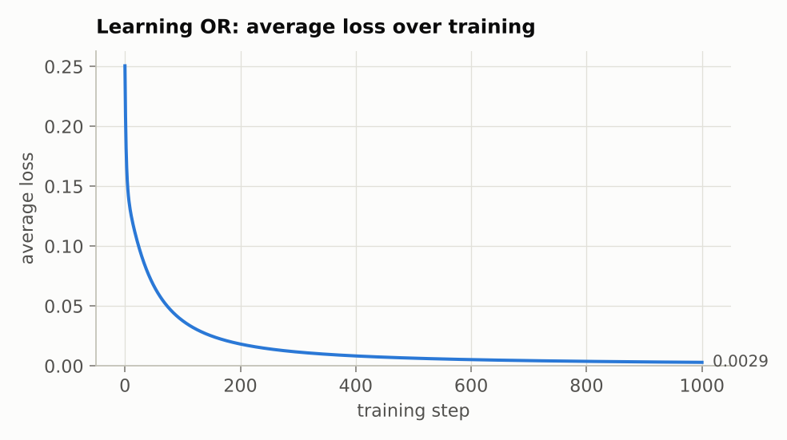
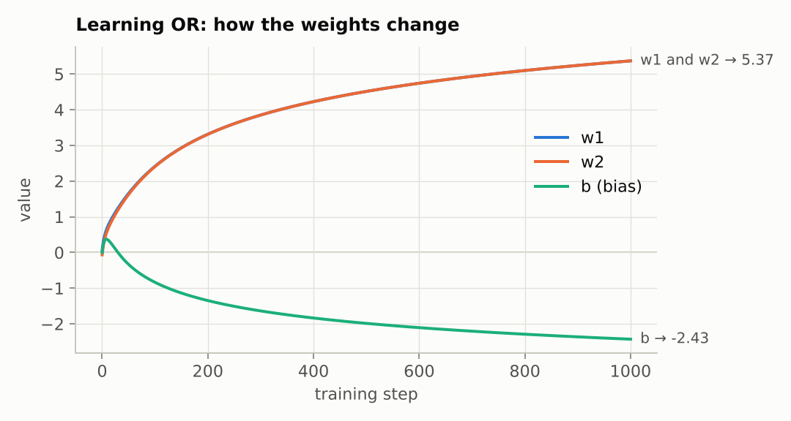
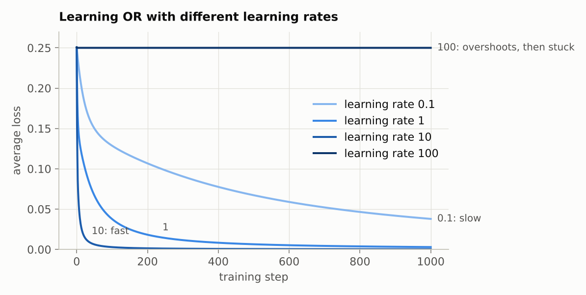
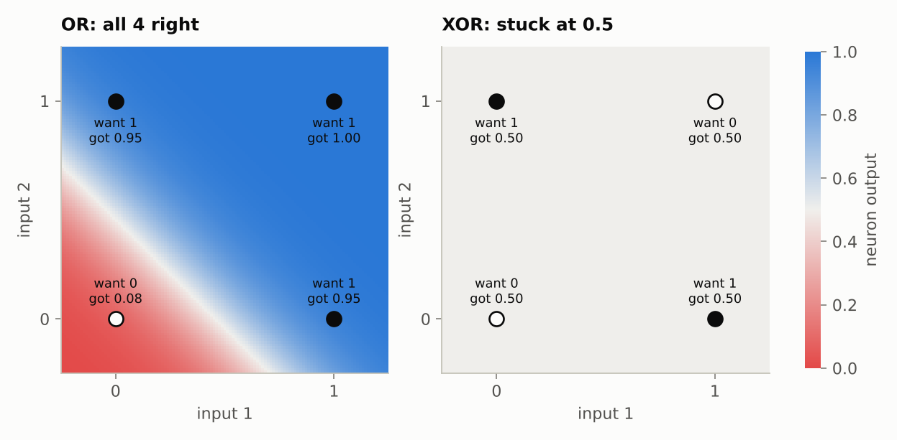

# Step 2: Training a neuron on many examples

**Goal:** go from one example to a whole dataset, watch the weights settle over hundreds of steps, see what the learning rate does, and find the limit of a single neuron.

**Code:** `train()` in [`src/connect4/numpy_nn/neuron.py`](../../src/connect4/numpy_nn/neuron.py). The charts come from [`scripts/make_stage2_charts.py`](../../scripts/make_stage2_charts.py).

---

## 1. The dataset: OR

Two on/off inputs. The target is **OR**: 1 if either input is on.

| x1 | x2 | target |
|---|---|---|
| 0 | 0 | 0 |
| 0 | 1 | 1 |
| 1 | 0 | 1 |
| 1 | 1 | 1 |

Why such a tiny problem? You can see everything: 4 examples, 3 numbers to learn. The Connect 4 version comes in step 4, and the mechanics are exactly the same.

## 2. Many examples: average the slopes

In step 1 there was one example, and each step moved the weights to fix it. Now there are four, and they want different things: `(0, 0)` wants the output pushed down, the other three want it pushed up. A step that fixes one example could make the others worse.

So each step works out the slopes for every example, **averages** them, and takes one step using the average. Every example gets a vote. From `train()`:

```python
for step in range(steps):
    total_weight_slopes = np.zeros_like(weights)
    total_bias_slope = 0.0
    for x, target in zip(inputs, targets):
        weight_slopes, bias_slope = gradients(weights, bias, x, target)  # step 1's function
        total_weight_slopes += weight_slopes
        total_bias_slope += bias_slope

    weights = weights - learning_rate * total_weight_slopes / len(inputs)
    bias = bias - learning_rate * total_bias_slope / len(inputs)
```

The starting weights are small random numbers. Here they come out as `w1 = 0.06`, `w2 = -0.07`, `b = 0`, so every prediction starts near 0.5.

## 3. Watching it learn

Predictions before and after 1,000 steps, with learning rate 1:

| x1 | x2 | target | before | after |
|---|---|---|---|---|
| 0 | 0 | 0 | 0.500 | 0.081 |
| 0 | 1 | 1 | 0.483 | 0.950 |
| 1 | 0 | 1 | 0.516 | 0.950 |
| 1 | 1 | 1 | 0.499 | 1.000 |



The loss falls fast at first, then more and more slowly: 0.25 at the start, 0.21 after 1 step, 0.13 after 10, 0.038 after 100, and 0.003 after 1,000. The same pattern as step 1: big slopes far from the answer, small slopes close to it.



What the neuron learned:

- `w1` and `w2` both climb to 5.37. They end up equal because OR treats both inputs the same way. Nobody told it that; it found it in the data. (The two lines start slightly apart and quickly merge.)
- The bias first rises, then sinks to -2.43. Early on, three of the four examples want the output higher, so everything goes up, the bias included. Once `w1` and `w2` have taken over the job of pushing the output up, the bias's job becomes holding `(0, 0)` down.

Read the final weights as a rule:

```
both off:  z = -2.43                    → sigmoid → 0.08   (off)
one on:    z = 5.37 - 2.43       = 2.94 → sigmoid → 0.95   (on)
both on:   z = 5.37 + 5.37 - 2.43 = 8.31 → sigmoid → 1.00   (on)
```

The bias holds the output down until at least one input switches on. That is OR, written as three numbers.

The outputs never quite reach 0 or 1. The weights keep growing slowly and the loss keeps creeping down for as long as you train. In practice you stop when it's good enough.

## 4. The learning rate: how big a step

The same training with four different learning rates:



- **0.1:** steady, but slow. After 1,000 steps it has only reached where learning rate 1 was after 100.
- **1 and 10:** faster.
- **100:** stuck from the very first step. That step is so large that all three numbers jump to about 12.5, and the neuron now outputs 1.00 for every input, including `(0, 0)`. Remember the second factor from step 1, "how responsive the neuron is": out at 1.00 the sigmoid is completely flat, so that factor is almost 0, every slope is almost 0, and the weights barely move again. The loss sits at 0.25 forever.

Too small is slow. Too big can overshoot into a place training can't get out of. Choosing the learning rate is one of the main practical skills in training networks; stage 3 introduces optimisers that adjust it automatically.

## 5. What one neuron can't do: XOR

**XOR** means 1 if exactly one input is on:

| x1 | x2 | target |
|---|---|---|
| 0 | 0 | 0 |
| 0 | 1 | 1 |
| 1 | 0 | 1 |
| 1 | 1 | 0 |

Same code, same settings. The loss never drops below 0.25, every prediction ends at 0.50, and all three numbers end at about 0. The neuron gives up.



The colours show the neuron's output for every point in the square, red near 0 and blue near 1. For OR, a single straight boundary (the pale band) separates the 0 from the 1s.

**A single straight line is the only boundary one neuron can draw.** The formula `z = w1·x1 + w2·x2 + b` is the equation of a straight line: `z` is positive on one side and negative on the other.

For XOR no straight line works. The 1s are at opposite corners, and so are the 0s. Any line that puts both 1s on one side also puts a 0 there. The best a single neuron can do is hedge at 0.5 everywhere, and that's what gradient descent found: the four examples' pushes cancel each other out.

### Why this matters for Connect 4

"Can I win by playing here?" depends on combinations: three of my pieces in a line, **and** the fourth cell empty, **and** the cell below it filled so a piece would land there. One neuron can't capture "this and this, but not that", for the same reason it can't do XOR.

The fix is more neurons, in layers. Each neuron in a **hidden layer** draws its own line, and a neuron in the next layer combines them. Two lines are enough for XOR. That's step 3, along with **backpropagation**, the method for finding the slopes of weights buried inside a network.

## Try it yourself

```python
import numpy as np
from connect4.numpy_nn.neuron import INPUTS, predict, train

and_targets = np.array([0, 0, 0, 1.0])  # AND: 1 only if both inputs are on
weights, bias, history = train(INPUTS, and_targets)
print(weights, bias, history[-1].loss)
print([round(float(predict(weights, bias, x)), 3) for x in INPUTS])
```

- **AND:** before running it, guess the signs of the final weights and bias. How should they differ from OR's?
- **XOR with learning rate 50:** `train(INPUTS, np.array([0, 1, 1, 0.0]), learning_rate=50)`. It ends up getting 3 of the 4 right, and the 4th completely wrong. The loss is still 0.25, the same as hedging. A different dead end, reached by a different path.
- **Different starting weights:** pass `seed=1`, `seed=2`, and so on. Does OR always end at the same place?

## Summary

- With many examples, each step averages the slopes from every example, so all of them get a vote.
- The weights settle into values you can read as a rule.
- The learning rate is the step size: too small is slow, too big can get stuck.
- One neuron can only draw one straight line. Anything that needs combinations needs layers of neurons.

---

**Previous:** [Step 1: One neuron, by hand](01-one-neuron-by-hand.md) · **Next:** Step 3: Hidden layers and backpropagation (coming)
