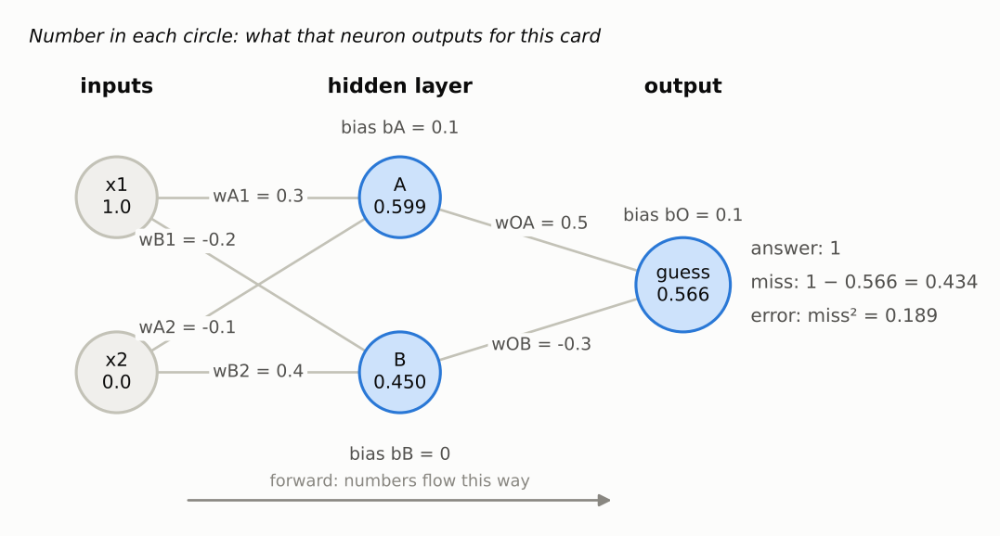
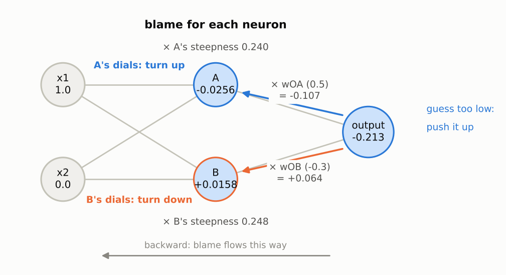

# Step 3a: A network with a hidden layer, by hand

**Read first:** [Start here](00-start-here.md), [Step 1](01-one-neuron-by-hand.md) and [Step 2](02-training-a-neuron.md).

**Goal:** wire three neurons into a small network, make one guess, then work out who is to blame for the mistake and which way to turn all 9 dials. This "passing the blame backwards" is **backpropagation**, the method every neural network uses to learn.

**Code:** [`src/connect4/numpy_nn/network.py`](../../src/connect4/numpy_nn/network.py). Run `python -m connect4.numpy_nn.network` to print every number on this page.

---

## 1. Why more neurons?

Step 2 ended with a problem: one neuron can only draw **one straight line**, and XOR needs **two**. The "yes" cards sit in opposite corners.

The fix is a team:
- two **hidden neurons**, A and B, each drawing its own line;
- one **output neuron** that combines what A and B report.

It's the company from the Start here page: two analysts each look at the facts and write a one-number summary, and the boss reads both summaries and makes the call.

## 2. The network



**How to read this picture.** Numbers flow left to right. Circles are neurons and lines are connections. Each connection is labelled with its dial (weight), and each neuron's bias is written beside it. The number inside each circle is what that neuron outputs for this card.

There are three neurons, and each one works exactly like the single neuron from step 1: multiply, add up, add the bias, squash.

| Neuron | Its inputs | Its dials |
|---|---|---|
| Hidden A | x1, x2 (the card) | `wA1`, `wA2`, bias `bA` |
| Hidden B | x1, x2 (the card) | `wB1`, `wB2`, bias `bB` |
| Output | **A's output and B's output** | `wOA`, `wOB`, bias `bO` |

That's **9 dials** in total. The key thing to notice: the output neuron's inputs aren't the card. They're what A and B say.

The starting dials are hand-picked to keep the arithmetic readable. Normally they'd be small random numbers.

## 3. Make a guess (the forward pass)

The card: inputs **(1, 0)**. The right answer for XOR is **1**.

**Hidden neuron A:**
```
total = wA1 × x1 + wA2 × x2 + bA
      = 0.3 × 1 + (−0.1) × 0 + 0.1
      = 0.4
output = squash(0.4) = 0.599
```

**Hidden neuron B:**
```
total = wB1 × x1 + wB2 × x2 + bB
      = (−0.2) × 1 + 0.4 × 0 + 0
      = −0.2
output = squash(−0.2) = 0.450
```

**Output neuron**, using A's and B's outputs as its inputs:
```
total = wOA × A + wOB × B + bO
      = 0.5 × 0.599 + (−0.3) × 0.450 + 0.1
      = 0.299 − 0.135 + 0.1
      = 0.264
guess = squash(0.264) = 0.566
```

**Error:** the miss, squared, just like page 1:
```
error = (guess − answer)²
      = (0.566 − 1)²
      = 0.434²
      = 0.189
```
(The program uses the unrounded guess, 0.5657, which is why this comes out as 0.189 and not the 0.188 you'd get from 0.434² on a calculator.)

**Total vs output.** Every neuron has two numbers, and the rest of this page uses both:

| Neuron | Total (before the squash) | Output (after the squash) |
|---|---|---|
| Hidden A | 0.4 | 0.599 |
| Hidden B | −0.2 | 0.450 |
| Output neuron | 0.264 | 0.566, the guess |

"Output" can mean two things: the **output neuron** (the last one, which makes the guess), or **a neuron's output** (its number after the squash). So the output neuron's *output* is the guess, 0.566, and its *total* is 0.264.

The guess is too low. Now: which of the 9 dials should turn, and which way?

## 4. Who's to blame? (the backward pass)

We'll give each neuron a **blame** number: how much the error would change if that neuron's total went up a little.
- **Negative blame** means its total should go **up**.
- **Positive blame** means its total should go **down**.
- The bigger the number, the more that neuron is responsible.

### 4.1 The output neuron: exactly like step 1

The output neuron is just a single neuron whose inputs happen to be A and B. So it uses step 1's gear ratios:

```
guess → error:  2 × (0.566 − 1)   = −0.869     (how wrong, and which way)
total → guess:  0.566 × 0.434     =  0.246     (the squash's steepness: how responsive it is)
output blame:   −0.869 × 0.246    = −0.213
```

The output neuron's dial slopes are its blame × each dial's input, just like step 1:

| Dial | Blame × input | Slope |
|---|---|---|
| `wOA` | −0.213 × 0.599 (A's output) | −0.128 |
| `wOB` | −0.213 × 0.450 (B's output) | −0.096 |
| `bO` | −0.213 × 1 | −0.213 |

### 4.2 Passing the blame back to A and B

Now the new part. A's dials don't touch the error directly. The chain is one link longer:

```
A's dial ──► A's total ──► A's output ──► output total ──► guess ──► error
```

We already know everything from "output total" onwards: that's the output blame, −0.213. We only need two more gear ratios for A:

1. **A's output → output total.** The output total is `wOA × A + …`, so if A's output goes up by a hair, the output total goes up by `wOA` times that. **The ratio is the connecting weight, wOA = 0.5.**
2. **A's total → A's output.** A's own **steepness**, the same kind of ratio as the 0.246 above but for A: `output × (1 − output) = 0.599 × 0.401 = 0.240`.

```
A's blame = output blame × wOA × A's steepness
          = −0.213      × 0.5  × 0.240
          = −0.0256          ← negative: A's total should go UP
```

The same for B, but B's connecting weight is **negative**:

```
B's blame = output blame × wOB  × B's steepness
          = −0.213      × −0.3  × 0.248
          = +0.0158          ← positive: B's total should go DOWN
```



**How to read this picture.** Blame flows right to left, along the same wires the numbers flowed forward on. Same network and same card as the first picture, but the number inside each neuron is now its **blame**, not its output. A's output is still 0.599; its blame is −0.0256. Blue means "push this neuron's total up", orange means "push it down".

**Why A and B get opposite blame.** The guess was too low.
- The output neuron listens to A **positively** (`wOA = +0.5`): when A says more, the guess goes up. So A should say **more**.
- It listens to B **negatively** (`wOB = −0.3`): when B says more, the guess goes **down**. So B should say **less**.

The sign of the connecting weight flips the direction of the blame.

**Analogy: the boss and her two analysts.** The boss is told her decision was too low. She passes the blame to each analyst according to how much she relied on them (the size of the weight) and whether she follows or goes against their advice (the sign). The analyst she follows is told "you should have said more". The one she goes against is told "you should have said less". Each analyst then adjusts how they read the facts, which is their own dials.

**One thing you predicted earlier:** this is where a weight's **value** appears in the chain. If `wOA` were 0, A would get zero blame and its dials would never move. That's one reason networks start with small random dials rather than zeros.

### 4.3 The hidden dials

Each hidden dial's slope is its neuron's blame × the dial's input, exactly as in step 1:

| Dial | Blame × input | Slope | Turn it… |
|---|---|---|---|
| `wA1` | −0.0256 × 1 (x1) | −0.0256 | up |
| `wA2` | −0.0256 × 0 (x2) | **0** | not at all |
| `bA` | −0.0256 × 1 | −0.0256 | up |
| `wB1` | +0.0158 × 1 (x1) | +0.0158 | down |
| `wB2` | +0.0158 × 0 (x2) | **0** | not at all |
| `bB` | +0.0158 × 1 | +0.0158 | down |

`wA2` and `wB2` don't move: their input, x2, is 0 on this card, so they played no part. That's the group-project rule from step 1 again.

## 5. Take the step

Turn all 9 dials a step downhill (step size 1): `new dial = old dial − slope`.

| Dial | Before | After |
|---|---|---|
| `wA1` | 0.3 | 0.326 |
| `wA2` | −0.1 | −0.1 |
| `bA` | 0.1 | 0.126 |
| `wB1` | −0.2 | −0.216 |
| `wB2` | 0.4 | 0.4 |
| `bB` | 0 | −0.016 |
| `wOA` | 0.5 | 0.628 |
| `wOB` | −0.3 | −0.204 |
| `bO` | 0.1 | 0.313 |

**New guess: 0.647**, up from 0.566 and closer to the right answer of 1. One round of training for a whole network.

## 6. That's backpropagation

Backpropagation in one sentence:

> **Start at the output and work backwards, one layer at a time: each neuron's blame is the blame passed back to it along its outgoing weights, times its own steepness. Then each dial's slope is its neuron's blame times the dial's input.**

Three things to notice:
- **It's the chain rule from step 1, extended.** Same gear ratios, just a longer chain.
- **No nudging.** Every number comes from values remembered during the forward pass: the inputs, A's and B's outputs, and the guess.
- **It's cheap.** One backward pass costs about as much as one forward pass, however many dials there are. That's what makes networks with millions of dials trainable.

**When a neuron feeds several neurons**, it gets blame from each of them, and you add the shares up. In the Connect 4 network (step 4), each hidden neuron feeds all 7 outputs, so its blame is the sum of 7 shares.

## 7. Checking it with the nudge test

To be sure the backpropagation code has no bugs, the program also finds every slope the slow way: nudge each dial up and down by a hair, re-measure the error, and divide. The two methods agree on all 9 dials:

```
  dial   backpropagation   nudging
  wA1   -0.025637        -0.025637
  wA2   +0.000000        +0.000000
  bA    -0.025637        -0.025637
  wB1   +0.015846        +0.015846
  wB2   +0.000000        +0.000000
  bB    +0.015846        +0.015846
  wOA   -0.127763        -0.127763
  wOB   -0.096068        -0.096068
  bO    -0.213406        -0.213406
```

The tests also run this check on bigger random networks with several outputs. Textbooks call it a **gradient check**.

## 8. In code

The code doesn't name the 9 dials one by one. Each layer keeps its weights in a grid (a **matrix**), with one column per neuron:

```
hidden_weights = [[wA1, wB1],      hidden_biases = [bA, bB]
                  [wA2, wB2]]

output_weights = [[wOA],           output_biases = [bO]
                  [wOB]]
```

So the same code works for 2 hidden neurons or 200. The `@` sign is matrix multiplication: `inputs @ hidden_weights` works out every hidden neuron's `w1×x1 + w2×x2` in one go, for every card at once.

The backward pass, from `slopes()` in `network.py`:

```python
# Output layer: the same three ratios as the single neuron.
error_per_guess = 2 * (guesses - answers) / count
error_per_output_total = error_per_guess * guesses * (1 - guesses)  # the output's blame
output_weight_slopes = hidden.T @ error_per_output_total  # blame × each dial's input
output_bias_slopes = error_per_output_total.sum(axis=0)

# Pass the blame back to the hidden neurons, along the connecting weights.
error_per_hidden_output = error_per_output_total @ net.output_weights.T
error_per_hidden_total = error_per_hidden_output * hidden * (1 - hidden)  # A's and B's blame
hidden_weight_slopes = inputs.T @ error_per_hidden_total
hidden_bias_slopes = error_per_hidden_total.sum(axis=0)
```

Line by line, that's sections 4.1, 4.2 and 4.3. (`count` is the number of cards × outputs, because the error is averaged over all of them. `.T` flips a grid on its side so the multiplication lines up.)

## Summary

- A network is neurons in layers. Each neuron works like the one in step 1; the hidden layer's outputs are the output neuron's inputs.
- **Forward pass:** compute layer by layer, left to right, and remember the numbers.
- **Backward pass (backpropagation):** compute each neuron's blame layer by layer, right to left. Blame passes back along the connecting weights, which can flip its sign.
- **Each dial's slope** = its neuron's blame × the dial's input. Then step downhill, as always.

## Try it yourself

Open Python in the project folder (after `source .venv/Scripts/activate`) and paste:

```python
import numpy as np
from connect4.numpy_nn import network as nw

card = np.array([[0.0, 1.0]])  # inputs (0, 1)
answer = np.array([[1.0]])
slopes = nw.slopes(nw.EXAMPLE, card, answer)
for name, value in nw.named_dials(slopes).items():
    print(name, round(float(value), 4))
```

Before running each one, guess:

- With the card **(0, 1)**, which dials get a slope of exactly 0 this time?
- Keep the card `(0, 1)` but change `answer` to `np.array([[0.0]])`. Which way do A's dials move now, and B's? Do the dials that were 0 change?
- Make a copy of the network with `wOB` set to 0 and look at B's dials. What happens to B's blame? Does `wOB` itself still get a slope? (Hint: what is `wOB`'s input?)

```python
e = nw.EXAMPLE
no_wOB = nw.Network(e.hidden_weights, e.hidden_biases, np.array([[0.5], [0.0]]), e.output_biases)
print(nw.named_dials(nw.slopes(no_wOB, nw.EXAMPLE_CARD, nw.EXAMPLE_ANSWER)))
```

---

**Previous:** [Step 2: Training a neuron on many examples](02-training-a-neuron.md) · **Next:** [Step 3b: Training a network on XOR](03b-training-a-network.md)
