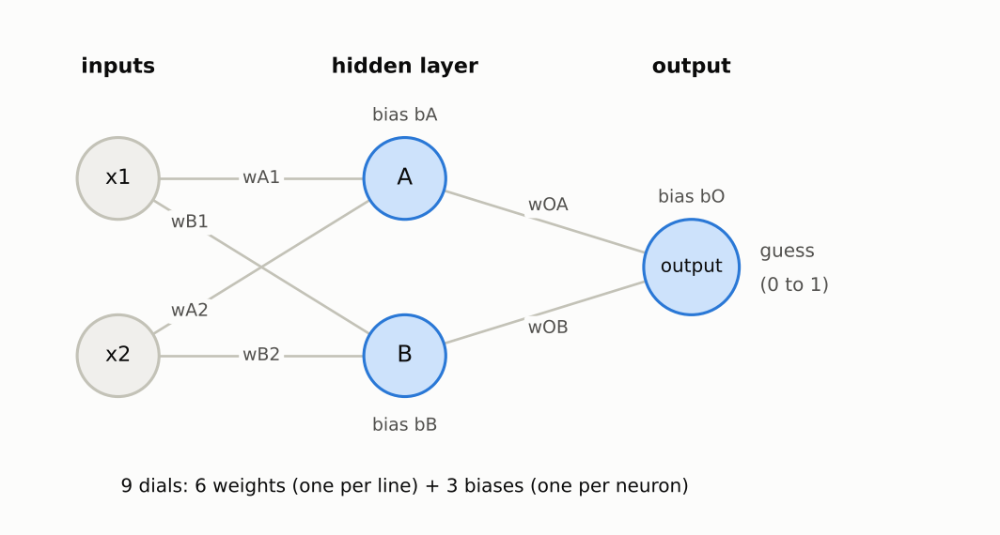
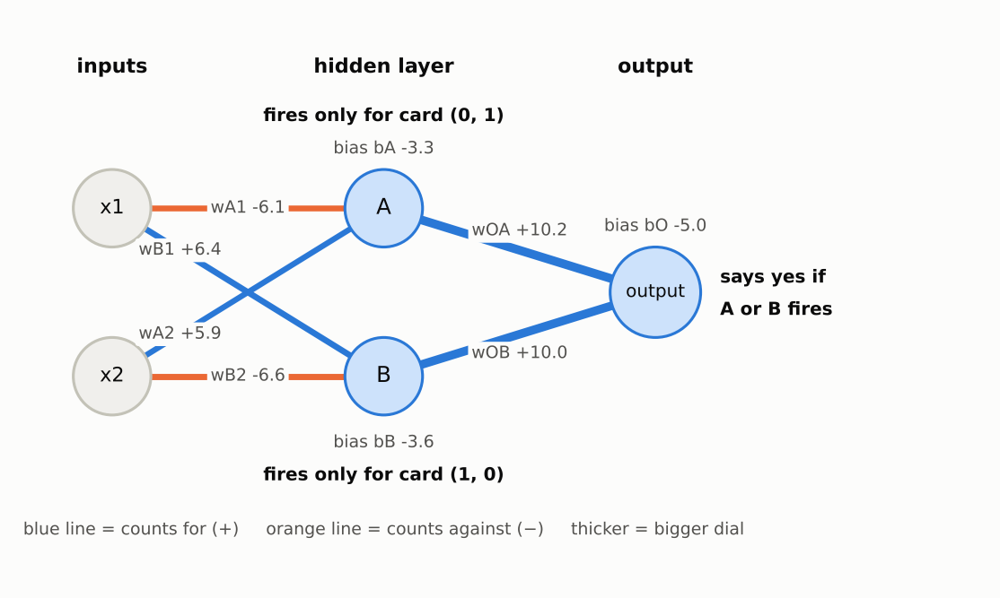
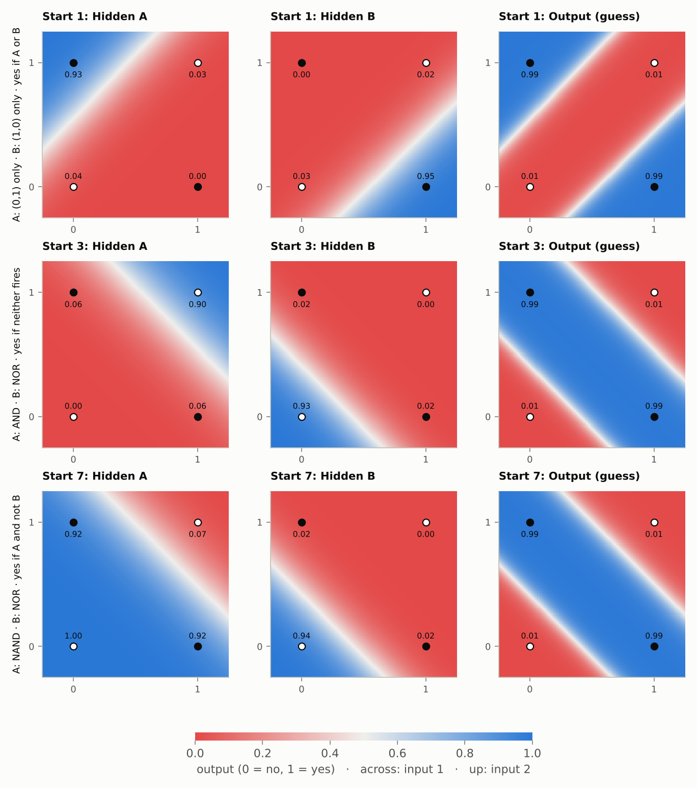

# Step 3b: Training a network on XOR

**Read first:** [Step 3a: A network with a hidden layer, by hand](03a-hidden-layer-by-hand.md).

**Goal:** train the small network on all four XOR cards, look inside to see what each hidden neuron learned, and see the ways training can still go wrong.

**Code:** `train()` in [`src/connect4/numpy_nn/network.py`](../../src/connect4/numpy_nn/network.py). The charts come from [`scripts/make_stage2_charts.py`](../../scripts/make_stage2_charts.py).

---

## 1. The network

It's the same shape as in step 3a: two inputs, two hidden neurons (A and B), and one output neuron.



**How to read this picture.** Numbers flow left to right. Each line is one weight (a dial) and each neuron has one bias (also a dial), so there are 9 dials in total. Every input connects to every hidden neuron, and every hidden neuron connects to the output.

Why only two hidden neurons? XOR needs two straight lines to separate its "yes" cards from its "no" cards, and each hidden neuron can draw one line. Two is the bare minimum. Section 6 shows what that costs.

Unlike step 3a, the dials don't start at hand-picked values. They start as small random numbers (random start number 1), and training has to find good values for all 9.

## 2. The training loop

Nothing new here. It's step 2's loop with step 3a's backpropagation inside:

1. Run all four cards through the network (forward pass).
2. Work out every dial's slope for every card with backpropagation, and average them so every card gets a vote.
3. Turn all 9 dials a step downhill.
4. Repeat 10,000 times.

The step size is 2.

## 3. It learns XOR

| Card | Right answer | Guess after training |
|---|---|---|
| (0, 0) | 0 | 0.01 |
| (0, 1) | 1 | 0.99 |
| (1, 0) | 1 | 0.99 |
| (1, 1) | 0 | 0.01 |

The single neuron in step 2 was stuck at 0.5 for everything. Two hidden neurons are enough to get all four right.


**How to read this chart.** Across the bottom: training rounds. Up the side: the average error over the four cards (lower is better). The two lines are the same network trained from two different random starting dials.

Follow the **blue line** (start 1):
- **Rounds 0–300: a long, flat stretch near 0.25.** Every guess is close to "no idea". The hidden neurons start almost alike and slowly drift apart as each begins to take on a different job.
- **Rounds 400–600: a sudden drop.** Once A and B have each found a useful job, the output neuron can combine them and the error falls fast: 0.19 at round 400, 0.07 at 500, 0.02 at 600.
- **After that, polishing:** 0.003 by round 1,000, 0.0001 by round 10,000.

A long plateau followed by a sudden drop is common when training networks, so a flat start doesn't necessarily mean training has failed. The orange line is a different story; it's in section 6.

## 4. What the hidden neurons learned

Each hidden neuron's output for each card, after training:

| Card | Hidden A | Hidden B | Guess |
|---|---|---|---|
| (0, 0) | 0.04 | 0.03 | 0.01 |
| (0, 1) | **0.93** | 0.00 | 0.99 |
| (1, 0) | 0.00 | **0.95** | 0.99 |
| (1, 1) | 0.03 | 0.02 | 0.01 |

- **A fires only for card (0, 1).**
- **B fires only for card (1, 0).**
- **The output says yes if either fires.**


**How to read this chart.** Each square shows one neuron's output for every possible pair of inputs, not just the four cards. Red means "no" (near 0), blue means "yes" (near 1), and pale means "not sure". Dots mark the four cards: filled dots should be "yes", hollow dots "no". The number under each dot is that neuron's actual output for the card.

- **Hidden A** draws one straight line, cutting off the top-left corner.
- **Hidden B** draws one straight line, cutting off the bottom-right corner.
- **The output** combines them: blue in both corners, red in the band between. That's **two lines**, which is what XOR needed and a single neuron couldn't draw.

**The trained network, drawn out:**



**How to read this picture.** Same layout as the first picture in section 1, now with the values training found. Blue lines count **for** (positive weight), orange lines count **against** (negative weight), and thicker lines are bigger dials. Follow one card through it. For (0, 1), only x2 is on:
- A gets +5.9 from x2, plus its bias −3.3: a total of +2.6, so A **fires**.
- B gets −6.6 from x2, plus its bias −3.6: a total of about −10, so B stays **off**.
- The output gets A's output (0.93) × 10.2 ≈ +9.5 from A, almost nothing from B, plus its bias −5.0: a total of about +4.5, so it says **yes** (0.99).

**The same dials as a table:**

| Neuron | Dials | Reads as |
|---|---|---|
| Hidden A | `wA1` −6.1, `wA2` +5.9, `bA` −3.3 | input 1 counts against, input 2 counts for, leans "no": **"input 2 on, input 1 off"** |
| Hidden B | `wB1` +6.4, `wB2` −6.6, `bB` −3.6 | the mirror image: **"input 1 on, input 2 off"** |
| Output | `wOA` +10.2, `wOB` +10.0, `bO` −5.0 | either one alone beats the −5 lean: **"A or B"** |

So the network built the circuit **(input 2 and not input 1) OR (input 1 and not input 2)**, which is exactly XOR. Nobody told it what A and B should do. Backpropagation worked out their jobs from the four flashcards.

## 5. Different starts, different circuits

Train from other random starting dials and the network often builds a **different** circuit that works just as well. (Cards in the order (0,0), (0,1), (1,0), (1,1).)

| Random start | A fires for | B fires for | Output says yes when |
|---|---|---|---|
| 1 | (0,1) only | (1,0) only | A or B fires |
| 3 | (1,1) only (AND) | (0,0) only (NOR) | neither fires |
| 7 | all but (1,1) (NAND) | (0,0) only (NOR) | A fires and B doesn't |

All three get every card right. There isn't one correct set of dials; there are many, and the random start decides which one training finds.



**How to read this chart.** One row per random start, with the same three panels as the chart in section 4: hidden A, hidden B, then the output. The label down the left of each row summarises that circuit. Colours and dots work as before: red is "no", blue is "yes", filled dots should be "yes", and the number under each dot is that neuron's output for the card.

- **Start 1:** A covers the top-left corner, B covers the bottom-right corner, and the output is blue in both.
- **Start 3:** A covers only the top-right corner (AND), B covers only the bottom-left corner (NOR), and the output is blue wherever *neither* fires: a band across the middle.
- **Start 7:** A covers everything except the top-right corner (NAND), B covers the bottom-left corner (NOR), and the output is blue where A fires and B doesn't: the same middle band.

**Look at the middle of each output square.** All three agree on the four cards, but not on the points in between. At (0.5, 0.5), start 1 says **no** (0.01) while starts 3 and 7 say **yes** (0.99). Nothing in the training cards says what the answer there should be, so each circuit fills the gap its own way.

That matters later. With Connect 4, most boards the network sees after training will be ones it never practised on. How it handles those depends on the circuit training happened to build, which is why the network is always tested on boards it hasn't seen.

## 6. When training gets stuck

Now the orange line in the learning curve chart: **random start 6**. It drops to 0.125 and stays there forever. Its final guesses:

| Card | Right answer | Guess | Hidden A | Hidden B |
|---|---|---|---|---|
| (0, 0) | 0 | 0.01 | 0.02 | 0.22 |
| (0, 1) | 1 | **0.50** | 0.00 | 1.00 |
| (1, 0) | 1 | 0.99 | 0.74 | 0.92 |
| (1, 1) | 0 | **0.50** | 0.00 | 1.00 |

Two cards right, two hedged at 0.5. **Look at the hidden outputs for (0, 1) and (1, 1): they're identical** (A = 0, B = 1), even though the cards themselves are different.

The hidden neurons did see a difference: their totals for the two cards are quite different.

| Card | A's total | A's output | B's total | B's output |
|---|---|---|---|---|
| (0, 1) | −13.8 | 0.000001 | 8.6 | 0.99981 |
| (1, 1) | −8.9 | 0.000139 | 12.3 | 0.99999 |

But all those totals sit far out on the flat ends of the squash, which flattens them to "0" and "1". After the squash the two cards differ by about one ten-thousandth. The output neuron never sees the cards, only A's and B's outputs, so for two cards that need opposite answers it receives the same description. It's like two different photos (a cat and a dog) that both analysts describe in exactly the same words: the boss only reads the descriptions, so to her it's the same description labelled "cat" once and "dog" once, and the best she can do is say 0.5 for both. **The hidden layer has thrown away the difference.**

To get out, the hidden neurons would have to change how they respond to those two cards. But their totals sit where the squash is almost perfectly flat (steepness between 0.000001 and 0.0002), so any blame passed back to A and B for those cards is multiplied by almost nothing, and their dials barely move. Every small change from here makes the error worse or leaves it flat. That's a **local minimum**: a hollow that isn't the deepest point, exactly as you described for your FYP.

**How often does it happen?** I trained from 20 different random starts:

| Hidden neurons | Learned XOR |
|---|---|
| 2 | 17 of 20 (3 stuck, like start 6) |
| 3 | 20 of 20 |
| 4 | 20 of 20 |

With just 2 hidden neurons there's no spare capacity: both must land on exactly the right jobs. With a third neuron there are more routes downhill, so training almost never gets boxed in. This is why real networks have far more neurons than the bare minimum, and why the Connect 4 network will have many hidden neurons rather than a handful.

## 7. Why the starting dials must be random

What if both hidden neurons start with identical dials (everything 0.5)?

```
after 10,000 rounds:
  A's weights: 8.26, 8.26
  B's weights: 8.26, 8.26        ← still identical
  guesses: 0.02, 0.67, 0.67, 0.67     error 0.167
```

They see the same inputs, get the same blame and take the same steps, every round, forever. Two identical twins behave like one neuron, and one neuron can't learn XOR. Random starting dials make every neuron slightly different, so blame pushes them in different directions and they can specialise.

## Summary

- The training loop is unchanged from step 2. Backpropagation is what lets it reach the hidden dials.
- Two hidden neurons each learned to draw one line, and the output combined them into the two-line shape XOR needs.
- Different random starts build different, equally valid circuits.
- Training can get stuck in a local minimum. Extra neurons make that much less likely.
- Starting dials must be random, or the hidden neurons stay identical twins.

You now have a complete, working neural network, trained by backpropagation and written by hand. It's the same machinery as the big ones, just smaller. **Next, step 4:** the same code on Connect 4 boards: 84 inputs, a bigger hidden layer, and 7 outputs, one per column.

## Try it yourself

Open Python in the project folder (after `source .venv/Scripts/activate`) and paste:

```python
import numpy as np
from connect4.numpy_nn import network as nw

net, history = nw.train(nw.XOR_INPUTS, nw.XOR_ANSWERS, hidden=2, seed=6)
print("final error:", round(history[-1], 4))
print("guesses:", np.round(nw.predict(net, nw.XOR_INPUTS)[:, 0], 2))
```

Before running each one, guess:

- Start 6 got stuck with 2 hidden neurons. Change `hidden=2` to `hidden=3`. Does it get unstuck?
- With `seed=1`, try `learning_rate=0.5`, `10` and `50`. Which learns fastest? Does any of them fail? (Hint: remember the step-size speed limit from step 2.)
- How many dials does a network with `hidden=3` have? Check with `net.dial_count()`.

---

**Previous:** [Step 3a: A network with a hidden layer, by hand](03a-hidden-layer-by-hand.md) · **Next:** [Step 4a: Connect 4 boards into numbers](04a-boards-into-numbers.md)
