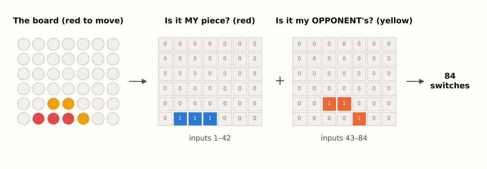

# Step 4a: Connect 4 boards into numbers

**Read first:** [Step 3b: Training a network on XOR](03b-training-a-network.md).

**Goal:** get everything ready to train a network on real Connect 4 positions: turn a board into numbers, make hundreds of thousands of flashcards with right answers, keep some back as an exam, and decide how to measure success.

**Code:** [`src/connect4/numpy_nn/winning_moves.py`](../../src/connect4/numpy_nn/winning_moves.py).

---

## 1. The question

For any board, the network answers 7 questions at once, one per column:

> **"If the player to move plays here, do they win right now?"**

This isn't yet the question your FYP answered ("how good is this position?"); that's stage 4. It's a stepping stone with one big advantage: the game engine from stage 1 knows the right answer for any board, so we can make as many correct flashcards as we like.

## 2. The network


It's the network from step 3, just bigger. The code is the same `network.py`.

| | XOR (step 3) | Connect 4 (step 4) |
|---|---|---|
| Inputs | 2 | **84** |
| Hidden neurons | 2 | **128** |
| Outputs | 1 | **7**, one per column |
| Dials | 9 | **11,783** |

Counting the dials the same way as before:
```
128 hidden neurons × (84 inputs + 1 bias)  = 10,880
  7 output neurons × (128 inputs + 1 bias) =    903
                                     total = 11,783
```

Saved to a file, that's about 90 KB. Your FYP's table of board scores ran to gigabytes.

## 3. Turning a board into numbers

Each cell can be empty, red or yellow, so one 0/1 switch per cell isn't enough. We use **two switches per cell**:



**How to read this picture.** The board on the left becomes two grids of switches, each laid out like the board. The first grid has a 1 wherever the player to move (red) has a piece. The second has a 1 wherever the opponent (yellow) has a piece. An empty cell is 0 in both. Together that's 2 × 42 = **84 inputs**, numbered from the bottom-left corner: inputs 1–7 are the bottom row of the first grid, 8–14 the row above, and so on.

**Why two switches, not one number per cell?** You could write each cell as one number: +1 mine, −1 opponent's, 0 empty. But "empty" then sits in the *middle*, between mine and theirs, and a single neuron can't single out a middle value. It's the same problem as XOR (step 2). With two switches, "empty" is simply "both off", which a neuron spots easily. Step 4b tests both versions, and the two switches win clearly.

**Why "mine" and "opponent's", not "red" and "yellow"?** The board is always described from the point of view of **the player about to move**. So one network serves both sides, and a pattern like "three of mine in a row" means the same thing whether you're red or yellow. It also gives us a free trick: to ask "can my *opponent* win here?", swap the two grids. Step 4b uses that for blocking.

In code:

```python
def encode(board):
    grid = board.grid
    me = board.current_player
    mine = (grid == me).ravel()  # 42 switches: is my piece here?
    theirs = (grid == other_player(me)).ravel()  # 42 switches: is my opponent's here?
    return np.concatenate([mine, theirs]).astype(float)
```

`.ravel()` flattens the 6 × 7 grid into a list of 42, row by row from the bottom.

## 4. The right answers

The back of each flashcard is 7 numbers: 1 for each column where the player to move wins right now, 0 for the others. The game engine works them out exactly with `winning_moves()`:

```python
def answers(board):
    result = np.zeros(7)
    result[board.winning_moves()] = 1.0
    return result
```

For the board in the picture: `[1, 0, 0, 0, 0, 0, 0]`. Red wins in column 1, nowhere else.

## 5. Making the flashcards

The positions come from **random games**: two random players play to the end, and every position along the way becomes a card (finished positions are skipped, since there's no move left to make).

- **300,000 practice cards**, used for training.
- **30,000 test cards**, kept back as the exam.
- **Every position appears only once.** Many random games start the same way, so the same early positions come up again and again; repeats are thrown away. That guarantees the test positions are ones the network **never** practised on.

That last point is the whole reason for test cards. Remember the XOR circuits that agreed on the four cards but disagreed about the space in between: a network can be right on everything it practised and still be wrong on new inputs. The test cards measure the thing we actually care about, getting **new** boards right.

What the cards look like:
- **35.5%** of the test positions have at least one winning move. Some have two or more.
- **For any one column, "yes" is rare:** only 4% (columns 1 and 7) to 10% (column 4, the middle) of positions. Middle columns win more often because more lines of four pass through them.

## 6. Measuring success

This needs some care, because the obvious measure is misleading.

**The trap.** Imagine a lazy network that always says "no" for all 7 columns. It's right about **94%** of individual column answers, because "yes" is so rare, and it gets all 7 answers right for **64.5%** of positions: every position that has no winning move. Yet it never finds a single win.

So we track several measures, each answering a plain question:

| Measure | The question it answers | "Always no" scores |
|---|---|---|
| **Finds the win** | Of positions *with* a winning move: how often does the network say "win" (above 0.5) for its top column, *and* that column really wins? | **0%** |
| **False alarms** | Of positions *without* a winning move: how often does it wrongly say "win" for some column? | 0% |
| **All right** | How often are all 7 answers on the correct side of 0.5? | 64.5% |
| **Error** | The average (guess − answer)², as in every step so far | 0.062 |

"Finds the win" and "false alarms" are the two that matter most. Together they answer "does it spot wins?" and "does it imagine wins that aren't there?". They're also exactly what a player using the network depends on.

## Summary

- **Inputs:** 84 switches, two per cell ("mine?" and "opponent's?"), from the point of view of the player to move.
- **Outputs:** 7 guesses, one per column: "does playing here win right now?".
- **Flashcards:** 300,000 practice and 30,000 test positions from random games, all different, with right answers from the game engine.
- **Success:** mainly "finds the win" and "false alarms", because a network that always says "no" would look good on simpler measures.

## Try it yourself

Open Python in the project folder (after `source .venv/Scripts/activate`) and paste:

```python
from connect4.board import Board
from connect4.cli import render_board
from connect4.numpy_nn import winning_moves as wm

board = Board.from_moves([3, 3, 2, 2, 1, 4])  # the board in the picture
print(render_board(board))
x = wm.encode(board)
print("my pieces:\n", x[:42].reshape(6, 7)[::-1])
print("opponent's pieces:\n", x[42:].reshape(6, 7)[::-1])
print("right answers:", wm.answers(board))
```

(`[::-1]` flips the grid so the bottom row prints last, like the board. `X` is red.)

Before running each one, guess:

- Where will the 1s be in each grid?
- Red doesn't spot the win and plays column 7 instead: `board = board.play(6)`. Now yellow is to move. Run the lines from `x = wm.encode(board)` again. Which grid are red's pieces in now? What are yellow's right answers, and why?
- Red's winning square is still open. Check with `wm.answers(board, player=1)`, which asks "where would *red* win?". If you were yellow, what would you do with that answer? (Step 4b builds a player that does it.)
- How many of the 84 switches are 1 now? Check with `x.sum()`.

---

**Previous:** [Step 3b: Training a network on XOR](03b-training-a-network.md) · **Next:** [Step 4b: Training on Connect 4](04b-training-on-connect-4.md)
