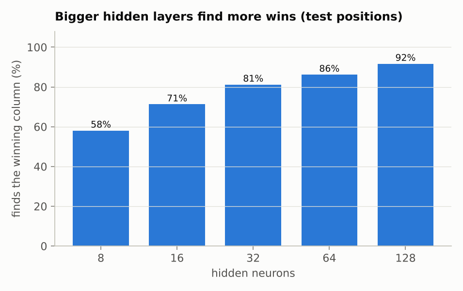
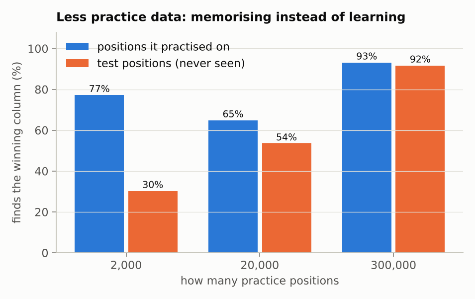
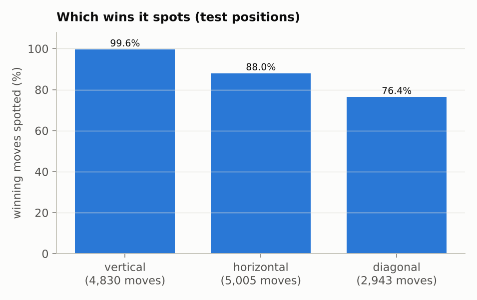

# Step 4b: Training on Connect 4

**Read first:** [Step 4a: Connect 4 boards into numbers](04a-boards-into-numbers.md).

**Goal:** train the network on 300,000 positions, check it on 30,000 it has never seen, look inside it to see what it learned, and play against it.

**Code:** [`src/connect4/numpy_nn/winning_moves.py`](../../src/connect4/numpy_nn/winning_moves.py) (training, the player) and [`network.py`](../../src/connect4/numpy_nn/network.py) (`train_in_batches`, `save`, `load`). The backpropagation code is exactly the same as in step 3.

---

## 1. Too many cards for one training round: mini-batches

In step 3, every training round used all 4 XOR cards: guess all four, average the slopes, turn the dials once. With 300,000 cards, one round would mean 300,000 guesses before the dials move even once. Far too slow.

The other extreme is one card per round. Each round is quick, but each card pulls the dials its own way, so they jitter about.

The usual answer is in between: a **mini-batch** of, say, 64 cards. Guess those 64, average their slopes, turn the dials once, then take the next 64.

**Analogy: asking for directions.** Asking everyone in the country before taking a single step is accurate but takes forever. Asking one stranger is quick, but they might be wrong. Asking a small crowd of 64 and going with the average is quick *and* usually points the right way.

Two more details:
- **Shuffle the deck** before each pass, so every mini-batch is a different mix of positions.
- One full pass through the deck is called an **epoch**. With 300,000 cards in batches of 64, one epoch is about 4,700 training rounds. We train for 50 epochs: about 234,000 rounds.

```python
def train_in_batches(net, inputs, answers, learning_rate, epochs, batch_size=64, seed=0):
    rng = np.random.default_rng(seed)
    for epoch in range(epochs):
        order = rng.permutation(len(inputs))  # shuffle the deck
        for start in range(0, len(inputs), batch_size):
            batch = order[start : start + batch_size]  # the next 64 cards
            net = train_step(net, inputs[batch], answers[batch], learning_rate)
    return net
```

`train_step` is the one from step 3, unchanged: forward pass, backward pass, turn every dial. It doesn't care whether it gets 4 cards or 64.

## 2. Training it

```bash
python -m connect4.numpy_nn.winning_moves
```

It takes a few minutes. It makes the positions, trains for 50 epochs, prints the scores on the test positions after every epoch, and saves the trained network to `models/winning-moves.npz` (about 90 KB).

The settings:
- **128 hidden neurons** (section 5 shows why).
- **Step size 10**, chosen by trying, like in step 2. At 20 the network got stuck: after 10 epochs it found only 16% of wins, against 77% with step size 10. It's bigger than step 3's 2 partly because the error is averaged over 7 answers per card, which makes each slope smaller.
- **Mini-batches of 64**, **50 epochs** (section 12 tries other choices).

## 3. Watching it learn


**How to read these charts.**
- Along the bottom of both: epochs, i.e. passes through the practice cards.
- **Left: the learning curve**, now with two lines. Blue is the error on the practice cards, orange on the test cards it never trains on. Both fall together, which is what you want. Orange stays a little above blue: it does slightly better on cards it has practised, which is normal.
- **Right: "finds the win" on the test cards.** 16% after one epoch, 68% after 5, 85% after 20, **92.9%** after 50.

After 50 epochs:

| | Practice positions | Test positions (never seen) | "Always no" (test) |
|---|---|---|---|
| **Finds the win** | 94.8% | **92.9%** | 0% |
| **False alarms** | 0.3% | **0.9%** | 0% |
| All right | 96.5% | 95.0% | 64.5% |
| Error | 0.0052 | 0.0070 | 0.0622 |

The test numbers are nearly as good as the practice numbers. Every test position is one it never saw, so it can't have memorised them. **It learned the rule**, or most of it, from examples alone. Your FYP's table could do nothing with a board it had never seen.

## 4. Some examples


**How to read this picture.** Each board is a test position. The bars above it are the network's 7 guesses, one per column, from 0 (no bar) to 1 (full bar). "wins" under a column marks a column that really wins. Each title says whose turn it is and which columns really win, then what the network made of it.

- **Top left:** red wins in column 5 by stacking a fourth piece. The network says 1.00 there and about 0 everywhere else.
- **Top right:** two winning columns (5 and 7), both found.
- **Bottom left:** no winning move, and the network says 0.00 for every column.
- **Bottom right: a mistake.** Yellow can win in column 1: the piece would land in row 5 and complete a diagonal running down to column 4. The network says 0.00. It missed it.

## 5. How many hidden neurons?



Same data and settings, 30 epochs each, different numbers of hidden neurons.

- More neurons find more wins: 58% with 8, up to 92% with 128.
- Why? Think of each hidden neuron as a pattern detector (section 8 shows what they look for). A Connect 4 board has **69 different lines of four**: 24 horizontal, 21 vertical, 24 diagonal. With 8 neurons there aren't enough detectors to cover them.
- The gains shrink: going from 8 to 16 neurons adds 13 points, from 64 to 128 about 5. More neurons also mean more dials, so training takes longer. 128 is a reasonable balance.

## 6. Memorising instead of learning

What if there were far fewer practice positions? Same 128-neuron network:



**How to read this chart.** Each pair of bars is one network. Blue is how often it finds the win on the positions it practised on; orange is on test positions it never saw. A big gap between the two means it's memorising.

- **2,000 positions:** 77% on its practice positions but only **30%** on new ones. It also imagines wins on 23% of new boards that have none, and its average error on new boards (0.071) is *worse than just saying "no" every time* (0.062). It memorised its cards instead of learning the rule.
- **20,000 positions:** the gap shrinks: 65% against 54%.
- **300,000 positions:** almost no gap: 93% against 92%.

(The 2,000 and 20,000 networks had the same number of training rounds. The 300,000 network is the 128-neuron one from section 5.)

This is the most important habit in machine learning: **always check on data the network didn't practise on.** The practice score alone would have said the 2,000-position network was doing fine. Textbooks call memorising **overfitting**. The main cure is more, and more varied, practice data; stage 3 shows some others. Your FYP's table was the extreme case: perfect on boards it had seen, nothing on new ones.

## 7. Two switches per cell, or one number?

Step 4a chose two switches per cell over one number per cell (+1 mine, −1 opponent's, 0 empty). Does it matter? Here's the same network trained both ways (64 hidden neurons to save time, 30 epochs, two step sizes). The numbers are "finds the win" on the test positions:

| The board as... | Step size 10 | Step size 20 |
|---|---|---|
| 42 numbers (+1 / −1 / 0) | 67.2% | 77.6% |
| 84 switches (two per cell) | **86.2%** | **91.4%** |

The two switches win clearly. With one number per cell, "empty" sits in the middle, between "mine" and "opponent's". A single neuron can only lean one way on a number ("more mine is better" or "more opponent's is better"), so it can't single out "empty": the same problem as XOR. The network has to spend extra hidden neurons untangling it. With two switches, "empty" is simply "both off", and one neuron can spot it.

(Step size 20 works for this smaller network, though it got the 128-neuron one stuck. The best step size depends on the network.)

The lesson: **how you describe the inputs matters.** The same network, with the same dials, learns much better from a clearer description. (Textbooks call this the *input encoding*.)

## 8. Looking inside: what did the hidden neurons learn?

Nobody told the network about lines of four. So what are its 128 hidden neurons looking for? Their weights tell us.

**First, what one hidden neuron is.** It's the same kind of neuron as in step 1, just with more inputs. It has **84 weights**, one for each input switch, plus a bias. Given a board, it multiplies each switch (1 if that piece is there, 0 if not) by its weight, adds them all up with the bias, and squashes the total into an output between 0 and 1. Near 1 means its pattern is on the board: the neuron *fires*. Near 0 means it isn't.


**How to read this picture.**
- **There's no board here.** The picture shows each neuron's 84 **weights**, read straight out of the trained network and drawn in the shape of the board, so each weight sits on the cell its switch belongs to.
- Each pair of grids is **one hidden neuron**. The left grid holds its 42 weights for "is **my** piece here?". The right grid holds its 42 weights for "is my **opponent's** piece here?".
- **Blue** is a positive weight: a piece in that cell pushes the neuron towards firing. **Red** is negative: a piece there pushes it away from firing. Pale is close to 0: the neuron doesn't care about that cell. Empty cells add nothing, because both their switches are 0.
- **The same cell appears in both grids,** often blue in one and red in the other. That isn't a contradiction. A cell holds at most one piece, so on any board only one of its two weights is used: the left one if my piece is there, the right one if my opponent's is. Blue on the left and red on the right means "I want *my* piece here, and definitely not my opponent's". Blue in *both* means "I want this cell filled, by anyone" (neuron 127 below).
- Rows are numbered from the **bottom**, like the board: row 1 is the bottom row.
- **"Votes for column 6"** says which output this neuron feeds. Every hidden neuron's output goes to all 7 output neurons, each through its own weight. Neuron 108's weight into the "column 6 wins" output is **+15.2**; into the other six it's between −0.3 and +0.6. So when neuron 108 fires, it pushes the network's answer for column 6 strongly towards "yes" and hardly touches the rest. These six are the neurons with the biggest vote for any single column.

**Neuron 108, close up.** Its weights outside column 6 are all small (between −1.5 and +0.6), so it mostly ignores the rest of the board. Here are its weights in column 6, and its bias is −3.0:

| Row (from the bottom) | My piece there | Opponent's piece there |
|---|---|---|
| 6 | −0.4 | −3.6 |
| 5 | **+4.7** | −2.3 |
| 4 | **+2.2** | −5.0 |
| 3 | **+5.4** | −4.7 |
| 2 | **+1.0** | −3.2 |
| 1 | −0.1 | −1.4 |

The two darkest blue cells in the picture are rows 3 and 5. Here it is on two boards, adding up column 6 only (the rest of the board adds a little either way):

- **Column 6 holds, from the bottom: opponent's, mine, mine, mine.** Total = −1.4 + 1.0 + 5.4 + 2.2 − 3.0 = **+4.2**, which squashes to about 0.98, so it fires. Rightly: the next piece lands in row 5 and makes four.
- **Column 6 holds mine, mine, mine, then an opponent's piece on top.** Total = −0.1 + 1.0 + 5.4 − 5.0 − 3.0 = **−1.7**, which squashes to about 0.15, so it stays quiet. Rightly: the stack is blocked.

**Which row is it aiming at?** None. A move is a column, and gravity decides the row. A stack of three can sit at different heights depending on what's underneath it: rows 1–3, 2–4 or 3–5. One neuron covers all of them with one sum, which is why rows 2 to 5 are all blue, by different amounts. In words, neuron 108 asks: **"Are the top pieces in column 6 three of mine, with no opponent's piece in the way?"** If so, dropping a piece in column 6 makes four, so it votes for column 6.

Checked on the test positions:

| Column 6, from the bottom | Positions | Neuron 108 fires | Column 6 really wins |
|---|---|---|---|
| mine, mine, mine | 410 | 73% | 100% |
| opponent's, mine, mine, mine | 194 | 92% | 100% |
| opponent's, opponent's, mine, mine, mine | 36 | 83% | 100% |
| mine, mine, mine, opponent's (blocked) | 232 | 0% | 0% |
| opponent's, mine, mine (only two of mine on top) | 610 | 19% | 3% (along a row or diagonal) |
| any column 6 with an opponent's piece on top | 13,998 | 0.0% | |

It isn't perfect on its own. It misses about a quarter of the plain "mine, mine, mine" stacks, and sometimes fires when only two of mine are on top. Other neurons fill the gaps (neuron 93 also votes for column 6). The network's final answer for column 6 says "win" for 94–100% of the real stacks in this table, and for 2% or fewer of the others.

**The other five:**

- **Neurons 32, 34, 59 and 93**: the same idea for columns 4, 1, 3 and 6.
- **Neuron 127**, bottom left, is cleverer. Blue cells for my pieces climb a diagonal: column 1 row 1, column 2 row 2, column 3 row 3. And row 3 of column 4 is blue in *both* grids: the neuron wants that cell filled, and doesn't care whose piece is there. Then the next piece dropped in column 4 lands in row 4, and completes the diagonal. **It worked out gravity**, from examples alone. It votes for column 4.

The network invented these detectors for itself, because they helped it get the answers right. This is what "the hidden layer finds useful patterns" from page 0 looks like for real.

## 9. Which wins does it miss?

Most of the strongest detectors are vertical. Is it better at some kinds of win than others? Here are the winning moves in the test positions, sorted by the direction of the four in a row they complete (the few that complete two lines at once are left out):



"Spotted" means the network's guess for that column is above 0.5.

- **Vertical: 99.6%.** The easiest pattern: three of mine at the top of a column, and the next piece always lands right on top.
- **Horizontal: 88.0%.** The winning square must be supported by a piece underneath it, or the piece falls further down. So the detector needs an extra condition.
- **Diagonal: 76.4%.** Four different columns, each at a different height, and the winning square must be supported. The hardest pattern, and the kind it missed in section 4.

## 10. Blocking: seeing the board from the opponent's side

To block, a player needs to know where the *opponent* could win. The network was only ever asked "where can **I** win?". But remember the trick from step 4a: swap the two halves of the input, and the opponent's pieces become "mine".

```python
x = encode(board)
mine = predict(net, x)  # where can I win?
theirs = predict(net, swap_sides(x))  # where could my opponent win?
```

So before every move, the player asks the network **two questions about the same board**: once as it is, and once with the halves swapped. No piece is dropped into any column to find out. The network looks at the current board and answers for all 7 columns at once.

![Left: one board with red to move. Red has three in a row along the bottom and can win in column 4; yellow has three stacked in column 7 and could win there. Above the board are two rows of bars. Question 1, "where can I (red) win?", says 0.95 for column 4 and 0.00 everywhere else. Question 2, "where could my opponent (yellow) win?", says 0.99 for column 7 and 0.00 everywhere else. Right: a bar chart over the test positions. Question 1 finds the winning column 92.9% of the time, with 0.9% false alarms. Question 2 finds it 93.2% of the time, with 1.1% false alarms](images/04-two-questions.png)

**How to read this picture.**
- **Left: one board, both questions.** Red is to move. The blue bars answer question 1, "where can I win?": 0.95 for column 4, where red would complete four along the bottom. The orange bars answer question 2, on the same board with the halves swapped: 0.99 for column 7, where yellow would complete a stack of four. Under the board, "red wins" and "yellow wins" mark the right answers.
- **Right: how well each question is answered** across all 30,000 test positions. Each bar is "finds the win": of the positions where that player has a winning move, how often the network's top column is a real win. The false alarms are under each bar: how often it claims a win that isn't there.

On this board both questions find a win. The network doesn't decide which matters more. The player's rules do, and winning comes first (section 11).

The network never practised on swapped boards, and some of them can't even happen in a real game: the "player to move" has one more piece than the opponent. On the test positions it still finds the opponent's winning column **93.2%** of the time, with 1.1% false alarms. About as good as for its own moves.

Why does this work? Because what it learned is "three of *mine* in a line, with a supported gap". Swapping the halves makes the opponent's pieces look like mine, so the same detectors fire.

## 11. Playing against it

The neural player follows the heuristic bot's strategy, but sees through the network instead of the game engine:

```python
def choose_move(self, board):
    legal = board.legal_moves()
    mine, theirs = self.guesses(board)
    for guesses in (mine, theirs):  # winning comes first, then blocking
        best = max(legal, key=lambda col: guesses[col])
        if guesses[best] > 0.5:
            return best
    return self._rng.choice(legal)
```

1. If the network thinks one of my moves wins, play it.
2. Otherwise, if it thinks my opponent could win somewhere, block that column.
3. Otherwise, play randomly.

Try it:

```bash
connect4 --p2 neural                              # you (X) against the network (O)
connect4 --p1 neural --p2 random --games 1000     # bot vs bot, prints a tally
connect4 --p1 neural --p2 heuristic --games 1000
```

1,000 games each:

| Player 1 (X) | Player 2 (O) | Neural wins | Opponent wins | Draws |
|---|---|---|---|---|
| neural | random | **93.7%** | 6.0% | 0.3% |
| random | neural | **91.5%** | 8.2% | 0.3% |
| neural | heuristic | 38.3% | **59.2%** | 2.5% |
| heuristic | neural | 33.4% | **64.0%** | 2.6% |

It beats the random player easily. But it **loses to the heuristic bot**, even though they follow the same strategy.

**Why?** The heuristic bot sees every win and every threat perfectly. The network handles 94.1% of these "win or block" moments correctly (measured on the positions of 300 random games). That sounds high, but a game has many such moments, and one slip usually loses it. If a game has 10 of them, getting every one right at 94% each happens only about half the time (0.94 × 0.94 × ... ten times ≈ 0.54).

**The lesson:** 93% sounds great on a test, but small error rates add up when decisions are chained together. Stage 3 aims for much closer to 100%.

## 12. Could we just train longer, or differently?

Section 2 picked 50 epochs and batches of 64 without trying anything else. Both are settings you choose before training starts, like the number of hidden neurons and the step size (textbook: *hyperparameters*). What happens if you change them?

**Training longer.** The same network, carrying on past 50 epochs:

| Epochs | Practice: finds the win | Test: finds the win |
|---|---|---|
| 50 (the network above) | 94.8% | 92.9% |
| 100 | 96.5% | 95.1% |
| 200 | 97.3% | 95.9% |
| 300 | 97.6% | 96.2% |
| 500 | 97.9% | 96.1% |

The next 50 epochs help, then it levels off at about 96%: ten times the training buys about 3 points. After about 300 epochs the practice score still creeps up while the test score doesn't, which is the start of memorising. More passes over the same cards can't get past the network's own limits: its size, and the slow-learning squash and error measure that stage 3 replaces.

**Bigger or smaller batches.** The same network and step size, 10 epochs each, changing only how many cards go into each batch:

| Cards per batch | Dial turns per epoch | Test: finds the win after 10 epochs |
|---|---|---|
| 4 | 75,000 | 93.9% |
| 16 | 18,750 | 94.8% |
| **64** (section 2) | 4,688 | 76.9% |
| 256 | 1,172 | 44.0% |
| 1,024 | 293 | 9.6% |
| 300,000 (the whole deck) | 1 | 0.0% |

Smaller batches turn the dials more often, so they learn more per epoch, until each turn is based on so few cards that the dials jitter (4 is already slightly worse than 16). Batch 16 is the best of these: after 50 epochs it finds **97.2%** of wins, against 92.9% for batch 64.

The usual way to make bigger batches work is to take bigger steps to match. Here it fails: batches of 64 or 256 with step size 40, or 256 with step size 160, got stuck at 0%. The big steps push the neurons onto the flat part of the squash, where they stop learning.

**So why keep 64?** It's the usual default, and it suits the tools in stage 3, which make bigger steps safe; on a graphics card, a batch of 64 also takes about as long as a batch of 16. For this hand-built network batch 16 is better, but these notes keep 64 so every number stays comparable. The lesson: settings like these are worth testing rather than taking on trust.

## 13. What stage 3 will improve

Everything in this stage was built by hand, and kept simple on purpose. Stage 3 rebuilds it in PyTorch, a library used across the industry, and adds the standard improvements:

- **A better error measure for yes/no answers** (textbook: *cross-entropy*). With squared error, a guess that's confidently wrong sits on the flat part of the squash, so it learns slowly (the flat plains from step 2). Cross-entropy fixes that.
- **A different squash for the hidden neurons** (textbook: *ReLU*) that doesn't go flat at the top end.
- **A smarter way to turn the dials** (textbook: *Adam*) that adjusts the step size for each dial by itself.
- **A network built for grids** (textbook: *convolutional network*, or *CNN*). In section 8, the network learned the same vertical-stack detector separately for different columns. A CNN learns one small detector and slides it across the whole board, so a pattern learned in one place works everywhere.
- **Automatic slopes.** PyTorch works out every slope by itself, using the same backpropagation you wrote by hand in step 3.

## Summary

- **Mini-batches:** with 300,000 cards, turn the dials after every 64. One pass through the deck is an epoch.
- **Results:** on 30,000 positions it never saw, it finds the winning move 92.9% of the time, with 0.9% false alarms.
- **Memorising:** with only 2,000 practice positions it found 77% of wins on those but only 30% on new ones. Always check on data the network didn't practise on.
- **Describing the board:** two switches per cell beat one number per cell (86% against 67% with the same network).
- **Inside the network:** the hidden neurons invented their own detectors: stacks of three in a column, and even a diagonal that takes gravity into account.
- **Weak spot:** diagonals (76%), much harder than vertical lines (99.6%).
- **Blocking for free:** swapping "mine" and "opponent's" lets the same network find the opponent's wins.
- **In play:** it beats random 92–94% of the time but loses to the heuristic bot, because small error rates add up over a game.
- **Settings:** ten times the training only reaches about 96%. Batches of 16 would do better than 64 for this network (97.2%), but 64 is the usual default. Settings are worth testing.

That completes stage 2: a neural network built from scratch, trained, tested and playing Connect 4.

## Try it yourself

Before running each one, guess:

1. **A smaller network.** Train one with 16 hidden neurons for 10 epochs, saved to a different file:
   ```bash
   python -m connect4.numpy_nn.winning_moves --hidden 16 --epochs 10 --out models/small.npz
   connect4 --p2 neural --model models/small.npz
   ```
   What "finds the win" score do you expect? Then play it. Is it easier to beat than the full network?
2. **Find its weak spot.** Play the full network (`connect4 --p2 neural`). Set up a vertical threat in one game and a diagonal one in another. Which is it more likely to miss?
3. **Ask it directly.** Paste into Python:
   ```python
   from connect4.board import Board
   from connect4.numpy_nn import network as nw
   from connect4.numpy_nn import winning_moves as wm

   player = wm.NeuralPlayer(nw.load("models/winning-moves.npz"))
   board = Board.from_moves([3, 3, 2, 2, 1, 4])  # the board from step 4a
   mine, theirs = player.guesses(board)
   print("where can I win?        ", mine.round(2))
   print("where could they win?   ", theirs.round(2))
   ```
   Now try `Board.from_moves([3, 3, 2, 2, 1, 4, 6])`, where red played column 7 instead of winning. What should each line say now?

---

**Previous:** [Step 4a: Connect 4 boards into numbers](04a-boards-into-numbers.md) · **Next:** Stage 3: PyTorch (coming)
